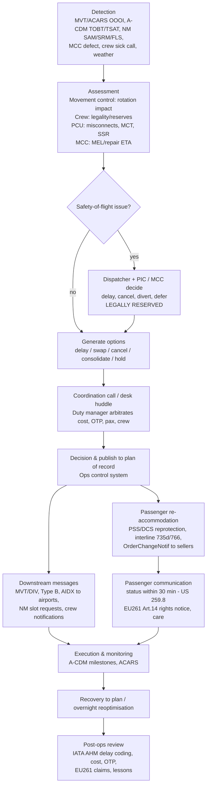
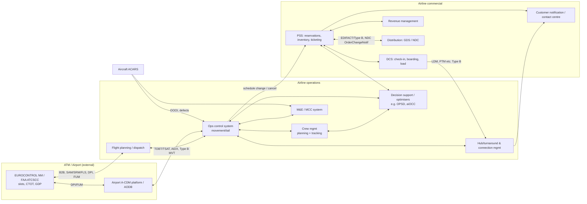

# 05 – OCC and Passenger Control Unit Workflows, Systems Ecosystem and Data Flows

> Scope: MASTER_PROMPT §15.7.6 (OCC/PCU workflows) plus §15.4.A and §15.4.E (operations domains and the technology ecosystem) as they support disruption management.
> Research question: *How can AI help an airline predict, assess and minimise the impact of flight disruptions on its network and passengers?*
> Status: first pass, researched 2026-11-20.
> Labels: `[STD]` standard/regulation · `[PRACTICE]` common industry practice · `[SPECIFIC]` one airline or vendor · `[ACADEMIC]` research · `[AI-OPP]` potential AI improvement · `[VALIDATE]` confirm with the airline.
> Related notes (same folder): [00-OVERVIEW](00-OVERVIEW.md) · [01 prediction](01-disruption-prediction.md) · [02 network impact & recovery](02-network-impact-and-recovery.md) · [03 passenger impact](03-passenger-impact.md) · [04 prioritisation & rights](04-passenger-prioritization-and-rights.md) · [05 OCC/PCU & systems](05-occ-pcu-workflows-and-systems.md). Sources: [`../../SOURCES.md`](../../SOURCES.md) (IDs are namespaced per note and final; no renumbering). Glossary: [`../../GLOSSARY.md`](../../GLOSSARY.md).

---

## 1. Key findings

- **Operational control is a legal concept, not just an org-chart box.** ICAO defines operational control as authority over the *initiation, continuation, diversion or termination of a flight* [S-O05]. In US Part 121 domestic and flag operations, the pilot in command (PIC) and the aircraft dispatcher are *jointly responsible* for preflight planning, delay and dispatch release [S-O01][S-O02]. In supplemental operations, the PIC and the Director of Operations share it [S-O02]. Any AI recommendation that touches go/no-go, fuel, route or diversion lands in this legally reserved space. `[STD]`
- **The EU model is different and is being rewritten.** Under EASA Air OPS, ORO.GEN.110(c) requires an operator *system* of operational control described in the operations manual [S-O04]. It does not require licensed dispatchers [S-O03]. A 2026 EASA draft decision (follow-up to NPA 2023-01) adds a new generic category, "operations control personnel", and a new Subpart ORO.OCP. It also confirms that in-flight authority remains with the commander (CAT.GEN.MPA.105) [S-O03]. This text was **draft at access date**. `[STD]` `[VALIDATE]`
- **OCCs share a common functional core.** The core is a supervisor or duty manager over aircraft (movement) control, crew control, maintenance control, flight dispatch and passenger services. Organisation types are "decision centre", "integrated centre" or a hub control centre (HCC) [S-O16][S-O15]. The FAA explicitly expects the business functions in a combined "Systems Operations Control Center" (SOCC) to be separated from operational control, so that commercial pressure never overrides safety [S-O02]. `[PRACTICE]` `[STD]`
- **Recovery is still largely sequential and manual.** Practice runs aircraft first, then crew, then passengers [S-O39][S-O18], with experience and rules of thumb [S-O16]. The best-documented production counter-example is the Lufthansa Group/Google OPSD at SWISS (INFORMS 2026). Controllers accepted 222,714 solver-suggested changes, 26% of all their changes, between January 2022 and January 2025. The paper reports CHF 8.5 M in savings from the Schedule Optimizer and a passenger sub-solver live since February 2025 [S-O18]. Humans still approve every change. `[SPECIFIC]` `[AI-OPP]`
- **Disruption data still moves on 1960s-era plumbing.** IATA Type B (teletype-format, store-and-forward over SITA/ARINC) carried about 188 M messages a day in 2019 and costs airlines over USD 1 bn a year. Order of delivery is not guaranteed, and it has no encryption or authentication [S-O09]. MVT movement messages are defined in IATA AHM 780 [S-O08]. A-CDM milestones [S-O06] and Network Manager B2B/DPI/slot messages [S-O07] are the modern, event-based layer on the ATM side. Any AI layer must reconcile late, out-of-order and duplicate messages. `[STD]` `[PRACTICE]`

Further findings:
- Passenger notification has hard time limits in some regimes. US 14 CFR 259.8 requires carriers to tell passengers about a delay of 30 minutes or more, a cancellation or a diversion **within 30 minutes** of becoming aware of it [S-O12]. EU261 Art. 14 requires written notice of rights [S-O13]. Southwest's December 2022 meltdown led to a USD 140 M DOT penalty, partly for flight-status notification failures [S-O28]. `[STD]` `[SPECIFIC]`
- Production AI in OCC and dispatch today is overwhelmingly **optimisation or ML decision support with human acceptance**. Examples are SWISS OPSD [S-O18], American's HEAT [S-O23], Alaska's Flyways (dispatcher accepts or rejects) [S-O24][S-O25] and Lufthansa Systems aiOCC (RL, "decision remains with the controller") [S-O20]. GenAI in production is mainly **customer messaging**: United's "Every Flight Has a Story" [S-O21][S-O22]. Vendor "agentic OCC" material is mostly roadmap or report-level [S-O26][S-O27]. `[SPECIFIC]`
- The vendor landscape has consolidated recently. CAE bought Sabre AirCentre (flight and crew ops) on 28 Feb 2022 [S-O29]. Boeing sold Jeppesen/ForeFlight to Thoma Bravo, closing on 3 Nov 2025 [S-O30]. Amadeus has owned Navitaire (the LCC PSS) since Jan 2016 [S-O31]. IBS iFlight went live at Korean Air, announced on 17 Mar 2026 [S-O32]. Older vendor maps that list "Sabre crew/ops" or "Boeing Jeppesen" are **outdated**. `[SPECIFIC]`

---

## 2. Domain fundamentals & terminology

| Term | Meaning | Source |
|---|---|---|
| OCC / AOCC / IOC / SOCC / NOC / HCC | Operations Control Centre: the entity that monitors execution of the plan and manages disruption. Airlines use different names: American calls its centre the "Integrated Operations Center" [S-O23], the FAA uses "Systems Operations Control Center" [S-O02], and an HCC is a hub control centre [S-O16]. The names are not standardised. `[PRACTICE]` | S-O16, S-O02, S-O23 |
| Operational control | "Exercise of authority over the initiation, continuation, diversion or termination of a flight in the interest of safety…and regularity and efficiency" (ICAO Annex 6 definition, quoted via a secondary glossary). `[STD]` `[VALIDATE]` wording against the current Annex 6 | S-O05 |
| Aircraft dispatcher (US) / FOO, flight dispatcher (ICAO) / operations control personnel (EASA draft) | A certificated dispatcher in the US who shares operational control with the PIC. EASA does not require a licence, and the draft rules introduce "operations control personnel". `[STD]` | S-O01, S-O02, S-O03 |
| Flight following / flight monitoring / flight watch | Graded levels of in-flight oversight. The FAA lists dispatch, flight following and flight locating in descending precision. EASA GM covers flight monitoring and flight watch. `[STD]` | S-O02, S-O03 |
| Maintenance Control (MCC) | Tracks airworthiness in real time, applies MEL/CDL, decides defer/repair and return to service, and supports the go/cancel/divert decision. `[STD]` (US guidance) | S-O02 |
| IROPS / IROP | "Irregular operations": a disruption on the day of travel or the day before that stops the customer using the ticketed flight. IATA Res. 735d separates it from a planned schedule change. `[STD]` | S-O11 |
| Involuntary reroute | Re-accommodation triggered by the carrier (it cancels a flight, fails to operate to schedule, misses a stop, cannot provide confirmed space, or causes a misconnect). `[STD]` | S-O11 |
| MVT / DIV | IATA Aircraft Movement Message (departure, arrival, delay, return) defined in AHM 780. DIV is the diversion variant within the movement-message family. `[STD]` (exact DIV format `[VALIDATE]`) | S-O08, S-O09 |
| LDM | IATA Load Message (crew, load and passenger figures by destination). The AHM chapter number (commonly cited as AHM 583) was **not verified** `[VALIDATE]`. | S-O08 (AHM), search evidence only |
| Delay codes | IATA standard delay coding. AHM 732 "process matrix" revisions with matching AHM 780 updates appear in the 47th (2027) edition. The legacy AHM 730/731 numbering `[VALIDATE]`. | S-O08 |
| Type B / Type X | Type B is IATA's teletype-format store-and-forward messaging, carried over SITA and ARINC networks plus AFTN. Type X is the IATA XML/web-services successor, which coexists with Type B through conversion gateways. `[STD]` | S-O09, S-O36 |
| ACARS / OOOI | Air-ground datalink. OOOI = Out (brake release and doors closed), Off (weight off wheels), On, In. These events feed actual times, crew pay and on-time performance (OTP). `[PRACTICE]` | S-O37, S-O09 |
| AIDX | IATA XML standard (RP 1797A; ACI 501A07) for operational flight data between airlines, airports and third parties. It has about 180 elements, including disruption details. `[STD]` | S-O10 |
| A-CDM, TOBT, TSAT | Airport Collaborative Decision Making. It has 16 milestones (MS1 ATC flight plan activation at EOBT−3h … MS10 TSAT issue … MS16 take-off). TOBT is owned by the aircraft operator by default and may be delegated to the ground handler. TSAT is issued around TOBT−30/−40 min, depending on the airport. `[STD]` | S-O06 |
| CTOT, SAM/SRM/SLC/FLS | EUROCONTROL NM ATFM slot (calculated take-off time). It is allocated by a Slot Allocation Message, revised by a Slot Revision Message, cancelled by SLC, and a flight can be suspended (FLS). The default slot tolerance window is −5/+10 min. `[STD]` | S-O07 |
| DPI / FUM | Departure Planning Information from A-CDM airports to NM (P-DPI from EOBT−48h, then E-, T-, A-DPI). The Flight Update Message gives the destination airport an ELDT from landing−3h. `[STD]` | S-O07 |
| GDP / EDCT / substitutions (US) | FAA ATCSCC traffic management. Airlines may swap controlled times under CDM substitution rules, and the ATCSCC may suspend substitutions. `[STD]` | S-O14 |
| OrderChangeNotif | NDC/ONE Order message by which the Offer Responsible Airline tells a seller about involuntary order changes (schedule change, cancellation, IROP). `[STD]` (IATA schema) / `[SPECIFIC]` (per-airline implementation) | S-O38 |

---

## 3. Stakeholders & responsibilities

Time horizon: Castro & Oliveira report that the OCC window typically runs from 72–24 h before to 12–24 h after the day of operation. This varies by airline [S-O16] `[ACADEMIC]` `[VALIDATE]`.

| Team | Needs (information) | Decides | Horizon | Human approval / legal authority |
|---|---|---|---|---|
| **Duty / Ops Manager (OCC supervisor, "Manager SOCC")** | Consolidated picture: delays, cancellations, ATFM restrictions, crew and aircraft shortfalls, cost/OTP/passenger impact | Arbitrates between teams. Approves major recovery plans (mass cancellations, hub bank reshuffles). Escalates to crisis management. Approves solver scenarios (in Castro's MAS concept the human supervisor applies the solution or not [S-O16]) | Hours to day-of. Next-day plan | Business authority. **Must not override safety-of-flight decisions** of the PIC/dispatcher; "marketing or financial motivation…[must] not adversely influence" operational control [S-O02] `[STD]` |
| **Flight Dispatch / FOO** | Weather, NOTAMs, airport conditions, aircraft performance/MEL status, ATC/ATFM slots, fuel, payload | Flight plan, route, fuel, alternates, dispatch release. Delaying or cancelling a flight that cannot be conducted safely. Slot requests [S-O02][S-O16] | EOBT−~3h to on-blocks. In-flight monitoring | **US:** PIC and dispatcher jointly responsible (121.533). Dispatcher can declare an emergency [S-O01][S-O02]. **EU:** the operator's OM defines who may decide initiation, continuation or diversion. Final in-flight authority remains with the commander [S-O03][S-O04] `[STD]` |
| **Network / Movement (Aircraft) Control** | Rotations, tail status, turn times, maintenance slots, slot/curfew constraints, load factors | Delays, tail swaps, cancellations, consolidations, ferry flights, spare aircraft. "The central coordination role" [S-O16] | Day-of to D+3 (OPSD reoptimises up to 3 days [S-O18]) | Internal approval by duty manager/policy. Note "advanced planning cancellations" before release do not need dispatcher input in the US [S-O02] `[STD]` |
| **Crew Control / Crew Tracking** | Rosters, check-in status, FTL legality (FAA Part 117, EASA ORO.FTL `[STD]`), reserves, positioning, qualifications | Reassign crew, call reserves, deadhead, hotel; re-plan pairings after aircraft changes | Real time to roster horizon | Legality is a hard constraint. The commander has discretion rules within FTL schemes `[VALIDATE]` per operator. Labour agreements constrain changes `[PRACTICE]` |
| **Maintenance Control (MCC)** | Aircraft defects, MEL/CDL items, deferrals, parts, station capability | Defer or repair; aircraft out of or back into service; unplanned maintenance; short-term maintenance scheduling [S-O02][S-O16] | Real time to days | **Return-to-service and airworthiness decisions belong to certifying maintenance personnel.** MCC supports, but does not replace, the PIC/dispatcher go/no-go [S-O02] `[STD]` |
| **Airport / Hub Control (HCC, turnaround control)** | A-CDM milestones (TOBT/TSAT), gate/stand, ground handling progress, transfer pax/bags | TOBT updates, gate changes, turnaround recovery (precision time scheduling), short holds for connections [S-O06][S-O19] | Minutes to hours | TOBT accuracy is the aircraft operator's responsibility (delegable to the handler) [S-O06] `[STD]`. Hold decisions follow airline policy `[VALIDATE]` |
| **Passenger Control Unit / Passenger Services / Hub transfer desk** | PNRs, connections and MCT, misconnect risk per passenger/crew/bag, alternative inventory, SSRs, status tiers, cost of reprotection | Protect or re-accommodate, hold or no-hold recommendations, hotel and vouchers, interline reroutes. Minimises passenger impact of OCC decisions [S-O16]. Connection Manager "categorizes the risk of misconnection for every passenger, crew and baggage" and the cost of reprotection [S-O19] | Day-of; D−1 | Passenger-rights obligations are hard constraints (see §6). Interline reroutes need bilateral agreement or direct contact with the new carrier [S-O11] `[STD]` |
| **Customer service / contact centres / airport agents** | Re-accommodation results, rights notices, disruption reason | Execute rebooking, refunds, care. Handle passenger-initiated changes | Real time to days after | Follow published policy, waivers and EU261/DOT obligations `[STD]` |
| **Customer communications ("storytellers")** | Ops notes, crew/ops chat, weather, delay causes | Wording and timing of passenger messages (United example [S-O21][S-O22]) | Minutes | Message must meet the 30-minute DOT notification rule in the US [S-O12] `[STD]` |
| **Revenue Management** (often indirect) | Inventory, forecasts, displaced revenue | Releasing or closing inventory for protection, upgauge decisions, waiver fare rules `[PRACTICE]` `[VALIDATE]`; the depth of RM involvement in day-of IROPS is **not well documented** | D−3 to day-of | Commercial. Must not override rights or safety [S-O02] |
| **ATC/ATFM liaison (NM FMP/NMOC, FAA ATCSCC)** | CTOTs, regulations, GDPs, reroutes | Request slot swaps/extensions, send DPI/REA/SWM, take part in CDM calls [S-O07][S-O14] | EOBT−3h to take-off; pre-tactical D−1 | ATC/NM/FAA decide slots. Airlines may only swap or substitute under the rules [S-O07][S-O14] `[STD]` |

**Decisions legally reserved or needing human authority (summary).** Any AI must be advisory here:
1. Dispatch release, delay or cancellation of an unsafe flight, and diversion: PIC and dispatcher (US) or the operator's OM-designated authority plus the commander (EU) [S-O01][S-O02][S-O03]. `[STD]`
2. Emergency declaration and emergency authority: PIC and/or dispatcher [S-O02]. `[STD]`
3. Airworthiness, MEL deferral and return to service: maintenance [S-O02]. `[STD]`
4. ATFM slot allocation: NM/ATCSCC, not the airline [S-O07][S-O14]. `[STD]`
5. Everything else (tail swaps, cancellations for commercial or resource reasons, hold policy, rebooking priority) is airline policy. It is usually approved by controllers and duty managers. Automation is legally possible but organisationally gated [S-O18] `[PRACTICE]`.

---

## 4. Business processes: IROPS workflow

**Narrative**
1. **Detection.** Signals come from movement messages (MVT, ACARS OOOI) [S-O08][S-O37], A-CDM milestone deviations and TOBT updates [S-O06], NM slot messages (SAM/SRM/SLC/FLS) [S-O07], FAA GDP/EDCT advisories [S-O14], MCC defect reports and crew sick calls [S-O16]. `[STD]` `[PRACTICE]`
2. **Assessment.** Each desk assesses its own resource. Castro & Oliveira and Kohl et al. describe aircraft, crew and passenger problems handled by specialised teams under a supervisor [S-O15][S-O16]. Tools such as NetLine/HubControl compute per-passenger misconnect risk and reprotection cost [S-O19] `[SPECIFIC]`.
3. **Safety gate.** If the issue affects the safe conduct of the flight, the dispatcher and PIC (US) or the OM-defined authority and commander (EU) decide. MCC decides airworthiness [S-O02][S-O03]. `[STD]`
4. **Options and coordination.** Options include delay, tail swap, cancellation, consolidation, upgauge and holding for connections. Practice is sequential (aircraft → crew → passengers) [S-O39]. Lufthansa/SWISS notes that decisions "must be made within minutes": a fast acceptable solution beats an optimal one that arrives too late [S-O18]. In the US, CDM conference calls with the ATCSCC shape GDPs [S-O14]. In Europe, NM runs CDM processes and tactical conferences [S-O07]. Internal coordination-call cadence and attendees are **not publicly documented** `[VALIDATE]`.
5. **Decision and publication.** The plan of record is updated in the ops control system. In OPSD, solver output was published as the plan of record 6–7 times a day [S-O18] `[SPECIFIC]`.
6. **Downstream messaging.** MVT/DIV and load messages go to stations and partners over Type B [S-O09]. AIDX feeds airports [S-O10]. Slot changes go to NM [S-O07].
7. **Passenger re-accommodation.** PSS/DCS tools reprotect passengers (Amadeus, Sabre; see §5). Interline reroutes follow IATA Res. 735d/766: the disrupting (original operating) carrier obtains inventory from the new carrier under a bilateral agreement or by direct contact (e.g. AIRIMP "NI" action code), then reissues only the impacted coupons with an involuntary indicator [S-O11] `[STD]`. NDC sellers get an OrderChangeNotif [S-O38].
8. **Passenger communication.** US carriers must notify within 30 minutes [S-O12]. In the EU, passengers get a written rights notice [S-O13]. Airlines add explanatory messaging (United) [S-O21].
9. **Recovery and reoptimisation.** OPSD separates the fast in-day IrrOptimizer from the overnight Schedule Optimizer, which "fixes tomorrow's suboptimalities" [S-O18]. A newer change: SWISS now reroutes passengers *as soon as* disruption is apparent rather than after they reach the hub [S-O18] `[SPECIFIC]`.
10. **Post-ops review.** This covers delay coding (IATA AHM) [S-O08], cost and claims reconciliation (EU261 claims can arrive years later [S-O18]), and regulator enquiries (Southwest/DOT) [S-O28]. The internal format of post-ops reviews `[VALIDATE]`.

---

## 5. Systems ecosystem & data flows

| System | Owns | Exchanges (examples) | Standard / protocol | Frequency | Example vendors (verified unless marked) |
|---|---|---|---|---|---|
| Operations control (movement) | Plan of record: legs, tails, delays, cancellations | Receives MVT/ACARS and slot info. Pushes schedule changes to PSS, crew, MCC, airports | Type B MVT/DIV [S-O08][S-O09]; AIDX [S-O10]; vendor APIs | Event-driven, seconds to minutes | Lufthansa Systems NetLine/Ops ++ [S-O20]; IBS iFlight (Korean Air, OCC live first) [S-O32]; CAE (ex-Sabre AirCentre) [S-O29]; AIMS [S-O40] `[VALIDATE]` scope |
| Decision support / optimisers | Recovery scenarios, cost evaluation | Reads aircraft, crew and PSS data through adapters into a common layer; writes accepted changes back [S-O18] | Proprietary APIs/middleware | Multiple solves per day; overnight | Google/LHG OPSD (in-house) [S-O18]; Lufthansa Systems aiOCC (RL) [S-O20]; American HEAT (in-house) [S-O23] |
| Flight planning / dispatch | OFP, fuel, routes, release | NM flight plans and slots; weather/NOTAM; ACARS uplink | ICAO FPL; NM B2B [S-O07]; ACARS | Per flight; re-plans | Jeppesen (now Jeppesen ForeFlight, Thoma Bravo) [S-O30]; Lufthansa Systems (Lido) `[VALIDATE]`; Air Space Intelligence Flyways (route advisory) [S-O24] |
| Crew management | Pairings, rosters, legality, tracking | Takes tail/leg changes from ops; sends crew notifications | Proprietary; crew portals | Real-time tracking; roster cycle monthly [S-O16] | CAE (ex-Sabre AirCentre crew) [S-O29]; IBS iFlight crew [S-O32]; AIMS [S-O40]; Jeppesen crew `[VALIDATE]` post-sale scope |
| M&E / MCC | Airworthiness, MEL deferrals, maintenance plan | Defects from ACARS; aircraft availability to ops | ATA Spec 2000 (relies on Type B) [S-O09] | Real time; daily planning | `[VALIDATE]`: vendors not researched in this pass |
| PSS (reservations, inventory, ticketing) | PNRs, inventory, e-tickets, orders | Gets schedule changes; reprotection; interline reissue | EDIFACT/Type B; IATA 735d/766 messaging [S-O11]; NDC [S-O38] | Event-driven | Amadeus Altéa (network carriers) [S-O35]; Navitaire (an Amadeus company, LCC) [S-O31]; Sabre (SabreSonic/Mosaic, IROPS Reaccommodation) [S-O33] |
| DCS | Check-in, seat, boarding, load and balance | Passenger lists; LDM; transfer messages | Type B (LDM etc.) [S-O09] | Per flight, minutes | Amadeus Altéa DCS (automates disruption transfers by "customer's unique value") [S-O35]; others `[VALIDATE]` |
| Hub / turnaround / connection management | Turn tasks, connections at risk | A-CDM, DCS, ops events | Vendor APIs; A-CDM | Minutes | Lufthansa Systems NetLine/HubControl (Connection Manager and Turnaround Manager) [S-O19]; Amadeus airport ops [S-O26] |
| Passenger re-accommodation | Re-protection solutions | PSS inventory; customer value; rules | Vendor | Batch per disruption, minutes | Amadeus schedule + passenger recovery [S-O34]; Sabre IROPS Reaccommodation (automated rebooking and re-seating; vendor claims) [S-O33] |
| Revenue management | Forecasts, availability controls | Inventory to PSS; displacement cost | Proprietary | Nightly batch plus intraday | `[VALIDATE]`: link to IROPS not documented in this pass |
| Distribution (GDS/NDC) | Agency bookings, orders | Schedule-change and IROP notifications to sellers | EDIFACT/Type B; NDC OrderChangeNotif [S-O38] | Event-driven | Amadeus, Sabre, Travelport [S-O09] |
| Airport A-CDM / AODB | Milestones, TOBT/TSAT, stands | DPI to NM; AIDX/Type B with airlines | EUROCONTROL A-CDM [S-O06]; DPI/FUM [S-O07]; AIDX [S-O10]; ACI ACRIS (in development) [S-O09] | Event-driven per milestone | Airport-operated `[PRACTICE]` |
| Messaging networks | Transport | Type B, Type X, ACARS | IATA Type B/X | Store-and-forward | SITA (SITATEX, Type X Distribution) [S-O36]; ARINC (Collins Aerospace) `[VALIDATE]` ownership in current source; each handles about 30 M Type B messages a day [S-O09] |

**Integration patterns.**
- *Type B store-and-forward*: the dominant legacy pattern. It has a priority indicator but no guaranteed order and no encryption. About 90% of traffic is passenger-handling related [S-O09] `[STD]`.
- *Type X/XML gateways* coexist with Type B through conversion services [S-O36].
- *APIs and event streams*: some airlines already use SQS, REST and XML internally behind Type B gateways. IATA suggests boundary gateways and AIDM-based JSON/XML as the transition path [S-O09] `[PRACTICE]`.
- *Adapter/common-data-layer* pattern for optimisers: in OPSD, "the most significant effort…was in preparing the input data", because crew, maintenance and booking databases differ even within LHG [S-O18] `[SPECIFIC]`.
- *Batch*: overnight schedule reoptimisation [S-O18] and RM forecasts `[PRACTICE]`.

---

## 6. Business rules & constraints

| Rule / constraint | Effect on OCC/PCU decisions | Label / source |
|---|---|---|
| PIC + dispatcher joint responsibility (US 121.533); PIC + DO (supplemental) | AI cannot release, delay-for-safety, cancel-for-safety or divert. It can only advise | `[STD]` S-O01, S-O02 |
| Separation of business from operational control (FAA SOCC guidance) | Cost or revenue optimisers must be architecturally prevented from pressuring safety decisions | `[STD]` S-O02 |
| EASA ORO.GEN.110(c): OM must describe the operational control system and who decides initiation, continuation, termination or diversion | Each EU operator's authority map differs. Read the OM before designing approvals | `[STD]` S-O04, S-O03 |
| MEL/CDL, maintenance return-to-service | Tail swaps must respect maintenance location and capability; "maintenance cannot be done at all stations" | `[STD]` S-O02; `[ACADEMIC]` S-O16 |
| Crew FTL (FAA Part 117 / EASA ORO.FTL) and labour agreements | Hard legality. Changes cost crew goodwill (OPSD minimises the number of crew changes) | `[STD]`; `[SPECIFIC]` S-O18 |
| ATFM slots: CTOT tolerance −5/+10 min; slot swaps only until a cut-off; FLS needs action from the airline | Delay and swap options are bounded by NM | `[STD]` S-O07 |
| A-CDM: TOBT must be accurate; operator responsible | Turnaround predictions feed the airport sequence. Bad TOBT means lost TSAT | `[STD]` S-O06 |
| US 259.8: notify within 30 min of a delay ≥30 min, cancellation or diversion; also update airport displays and subscribers | Notification pipeline is time-critical and auditable | `[STD]` S-O12 |
| EU261 Art. 14: written rights notice for denied boarding, cancellation, delay ≥2 h; Art. 5: carrier bears the burden of proving when it informed passengers of a cancellation; extraordinary circumstances must be proven | Communication logs are legal evidence. Cancellation timing affects compensation | `[STD]` S-O13 |
| IATA Res. 735d/766: delivering carrier rebooks misconnects; disrupting carrier absorbs expenses; interline reroute needs a bilateral agreement or direct contact; no cabin upgrade without consent | Constrains automated interline reaccommodation | `[STD]` S-O11 (based on PSC Manual effective 1 June 2020; check current edition) |
| Type B: no guaranteed order, batching, character set limits | Detection logic must be idempotent and order-tolerant | `[STD]` S-O09 |
| Airline commercial policies (protection priority, hold rules, waivers) | Vary by airline. Must sit **under** legal and safety constraints | `[PRACTICE]` `[VALIDATE]` |

---

## 7. Industry practice & real-world cases

| Case | Date | What it shows | Label / source |
|---|---|---|---|
| **TAP Portugal OCC (Castro & Oliveira; Castro, Rocha & Oliveira)** | 2011 chapter; 2014 Springer book | Organisation types (decision centre, integrated centre, HCC), roles (dispatch, aircraft control, crew control, maintenance, passenger services), rules of thumb dominate. The MASDIMA multi-agent prototype keeps the human supervisor as the final decision maker. Tested on real TAP crew problems: integrated method cut "quality" (passenger) costs by about 16.5% and total operational costs by about 4%, while direct operating costs rose about 10.5% | `[ACADEMIC]` S-O16, S-O17 |
| **Kohl et al., "Airline disruption management – perspectives, experiences and outlook"** | JATM 13(3), 2007 (tech report 2004) | Planning processes and the first prototype multi-resource decision support system at a major airline's OCC (Descartes project) | `[ACADEMIC]` S-O15 |
| **SWISS / Lufthansa Group + Google OPSD** | Collaboration 2019–2024; INFORMS JAA 56(1), 2026 | Integrated aircraft + crew + passenger recovery (IrrOptimizer) plus overnight Schedule Optimizer. 222,714 accepted changes (26% of controller changes), CHF 8.5 M and 14.7 kt CO₂ (Schedule Optimizer, to Jan 2025). Rollout to all LHG airlines with a target of EUR 30 M a year. Manual planning changed ≤20 rotations, OPSD >100 over 3 days. Passenger sub-solver live Feb 2025. In one anecdote the solver beat a controller with over a decade of experience by more than USD 200k | `[SPECIFIC]` S-O18 (authors include Google and LHG staff; not independent) |
| **American Airlines HEAT** | Press release 6 Jul 2023 | In-house tool used by the IOC to reshuffle hub arrivals and departures in storms, weighing weather, loads, connections, gates, ATC and crew. Claims about 1,000 cancellations prevented (company claim, unverified) | `[SPECIFIC]` S-O23 |
| **Alaska Airlines + Air Space Intelligence Flyways** | 2021 trial; 9 Aug 2024 update | Route recommendations to dispatchers, who accept or reject them. 2021 press release: 32% of recommendations accepted. 2024: opportunities found on 55% of flights, 1.2 M gallons saved. Other press figures (23%, one-third) **conflict**; date the metric before using it | `[SPECIFIC]` S-O24, S-O25 |
| **United "Every Flight Has a Story"** | Started 2018; GenAI beta Feb 2024; CIO interview 30 Apr 2025 | NOC staff enter key terms and templates go out automatically. "Storytellers" write messages for delays of about 60 min or more. GenAI drafts from flight facts, crew/ops chat and weather; full-story coverage went from 5% to 35% with the same headcount. Later press reports claim fully automated messaging with **conflicting accounts of human review** | `[SPECIFIC]` S-O21, S-O22; `[VALIDATE]` S-O41 |
| **Southwest Airlines holiday meltdown** | Dec 2022; DOT order 11 Dec 2023, announced 18 Dec 2023 | 16,900 cancellations, over 2 M passengers. USD 140 M penalty partly for flight-status notification failures. Shows that ops-control and crew-recovery failure becomes a passenger-rights and regulatory event. Root-cause attributions to a specific crew tool were **not verified** in this pass | `[SPECIFIC]` S-O28 |
| **Korean Air IBS iFlight** | Announced 17 Mar 2026 | OCC module went live first, then crew tracking and planning, on one cloud-native platform (vendor claim: "first full-scope iFlight deployment") | `[SPECIFIC]` S-O32 |
| **KLM + BCG ops control AI platform** | BCG article 29 Sep 2025 | Fleet/tail assignment optimisation using maintenance, crew and airport data. **Deployment status and figures not stated** | `[SPECIFIC]` `[VALIDATE]` S-O27 |

---

## 8. AI / technology opportunities

**Evidence tiers**

| Capability | Status | Evidence | Better done by |
|---|---|---|---|
| Integrated aircraft/crew/passenger recovery recommendations, human-accepted | **Proven in production** (SWISS; rolling out across LHG) | S-O18 | OR/optimisation (MIP, LNS, Benders) with rule engines. Not LLMs |
| Hub bank re-timing in storms | **Production, airline-claimed** | S-O23 | Optimisation plus weather forecasts |
| Dispatcher route advisory (turbulence, efficiency) | **Production, human accept/reject** | S-O24, S-O25 | ML plus optimisation, learning from rejections |
| Per-passenger misconnect risk and reprotection cost | **Commercial product** (vendor claims) | S-O19, S-O33, S-O34 | Rules/MCT plus ML probability of misconnect `[AI-OPP]` |
| RL-based prescriptive OCC assistant | **Vendor product, launched Feb 2024**; no independent results, no named customers on the product page | S-O20 | RL, still to be proven |
| GenAI passenger delay explanations | **Production at United** (scale and extent of human review unclear) | S-O21, S-O22 | LLM over structured ops data, with guardrails |
| Agentic turnaround coordination, voice rebooking agent | **Report/roadmap.** Amadeus says voice rebooking is "tested and ready for production"; airlines named are only "exploring" | S-O26 | Agents over APIs. Requires clean data foundations |
| Multi-agent negotiation across OCC desks | **Research/prototype** | S-O16, S-O17 | MAS plus optimisation |

**Concrete `[AI-OPP]` ideas for this research question**
1. **Disruption situational summariser.** An LLM fuses MVT/ACARS, NM slot messages, A-CDM, MCC notes and crew status into a desk-specific briefing and a draft coordination-call agenda. It is low-risk because it is advisory. It must cope with Type B ordering and duplication [S-O09].
2. **Decision trace and rationale generation.** It explains *why* an optimiser picked a scenario. This answers the trust problem seen in Flyways' acceptance rates [S-O25] and Castro's "rationale" shown to the human supervisor [S-O16].
3. **Rights-aware notification copilot.** It drafts compliant messages (259.8 timing, EU261 Art. 14 notice) and logs proof of notification [S-O12][S-O13]. Template and rules logic should own the compliance part; the LLM only does wording.
4. **Early passenger rerouting.** It triggers PCU re-accommodation when a disruption becomes *probable*, not when the passenger reaches the hub (the SWISS policy change) [S-O18]. This needs calibrated delay probabilities from `01-disruption-prediction.md`.
5. **Message normalisation layer.** ML/LLM parsing of free-text supplementary fields in Type B or ops chat into events. Conventional parsers handle the structured parts better.

**Where humans are essential**
- Legal: release, safety delay/cancel, diversion, emergency (PIC/dispatcher/commander) [S-O01][S-O02][S-O03]; airworthiness (maintenance) [S-O02].
- Organisational: trade-offs with crew and labour relations, VIP or political flights, crisis communication, and anything with "factors that are as yet unknown to the system". OPSD users routinely modify proposed scenarios for this reason [S-O18].
- Accountability: under EU261 the carrier bears the burden of proof [S-O13]. Automated messaging must be auditable.

---

## 9. Risks, limitations, airline-model differences

**Risks and limitations**
- *Data fragmentation*: crew, maintenance and booking data live in separate databases that differ across group airlines. Integration is the main cost [S-O18] `[SPECIFIC]`.
- *Legacy messaging*: Type B has no ordering guarantee, no encryption or authentication, and is exposed to address spoofing. GDPR/NIS2 concerns are raised. Expertise is retiring [S-O09] `[STD]`.
- *Trust and acceptance*: dispatchers accept only a minority of recommendations (23–33% in Flyways reporting), often for safety-comfort reasons [S-O25]. Optimisers that ignore unknown factors are overridden [S-O18].
- *Vendor claims*: most product figures (Sabre, Amadeus, Lufthansa Systems, IBS) are self-reported [S-O19][S-O20][S-O33][S-O34][S-O32].
- *Regulatory change in flight*: the EASA OCP rules are in draft [S-O03]. The AHM delay-code process changes in the 47th edition [S-O08]. US 259.8 should be checked against the current eCFR [S-O12].
- *GenAI accuracy*: passenger-facing explanations carry legal weight (e.g. stating "weather" can affect compensation claims under EU261 extraordinary circumstances [S-O13]). A hallucinated cause is a liability `[AI-OPP]` risk.

**Airline-model differences** (mostly `[PRACTICE]` and `[VALIDATE]`; little primary documentation found)

| Model | OCC/PCU characteristics | Evidence |
|---|---|---|
| Full-service hub carrier | HCC or hub control at each hub with transfer desks and connection management. Passenger services partly at airports [S-O16]. Bank-structured schedules make holds and bank re-timing central (HEAT) [S-O23]. Interline and alliance reroutes common [S-O11]. PSS typically Altéa- or Sabre-class [S-O35][S-O33] | S-O16, S-O19, S-O23 |
| LCC / point-to-point | Fewer connections, so passenger work is mostly rebook, refund and care rather than misconnect protection. Navitaire is the typical LCC PSS family [S-O31]. Limited or no interline makes alternative inventory scarce `[VALIDATE]` | S-O31 |
| Regional (incl. capacity-purchase operations) | Operational control stays with the operating certificate holder [S-O02], while the mainline partner's OCC often drives cancellations and priorities. **The split of authority is contract-specific** `[VALIDATE]` | S-O02 (principle only) |
| Charter / leisure (e.g. tour-operator airlines) | Low frequency, so few same-airline alternatives. Recovery may use sub-charter or wet lease. Tour-operator customers add a coordination layer `[VALIDATE]`. Smaller operators may combine dispatch, crew scheduling and customer service in one role (FAA "additional duties") [S-O02] | S-O02 |

---

## 10. Open questions / knowledge gaps / items to validate with an airline

1. Exact desk structure, names and headcount of the target airline's OCC and PCU, and where the PCU sits (OCC, hub or contact centre). `[VALIDATE]`
2. Who may approve: tail swaps, commercial cancellations, holds for connections (time limits?), interline protection, hotel spend. Is there a delegation matrix in the OM or ops policy? `[VALIDATE]`
3. EU operators: the current OM operational-control method, and readiness for the draft ORO.OCP subpart [S-O03]. `[VALIDATE]`
4. Coordination-call cadence (fixed daily calls vs event-triggered), attendees and records. No public primary source was found. `[VALIDATE]`
5. Revenue management's actual role during IROPS (inventory release for protection, displacement valuation). Not documented in sources found. `[VALIDATE]`
6. Message estate: which Type B messages (MVT, DIV, LDM, PTM, PSM, CPM, etc.) the airline sends and receives, through which provider, and whether AIDX or APIs exist. Several AHM chapter numbers (LDM = AHM 583, delay codes AHM 730/731) were not verified in primary text. `[VALIDATE]`
7. A-CDM and NM integration: which hubs are A-CDM or DPI airports, and who updates TOBT (airline or handler) [S-O06]. `[VALIDATE]`
8. Data latency and quality per feed (ACARS vs manual MVT, crew check-in). `[VALIDATE]`
9. The US 259.8 / EU261 notification audit trail: what is logged today? `[VALIDATE]`
10. GenAI governance: any existing policy on customer-facing AI text. Human-review rules (compare the conflicting United reports [S-O22][S-O41]). `[VALIDATE]`
11. Vendor landscape not covered in this pass: M&E systems, Collins Aerospace/ARINC current portfolio, Jeppesen crew/ops post-sale scope, Lufthansa Systems Lido. `[VALIDATE]`
12. ICAO Annex 6 Part I wording for operational control and FOO, and the current FAA AC 120-101 edition (CHG 1, 2016, used here). `[VALIDATE]`

---

## 11. Sources

All accessed 2026-11-20. Tiers follow MASTER_PROMPT §15.3. Where a primary text was not opened, the row says so.

| ID | Tier | Title | Publisher / author | Publication date | URL | Accessed | What it supports |
|---|---|---|---|---|---|---|---|
| S-O01 | 1 | 14 CFR §121.533 Responsibility for operational control: domestic operations | US eCFR via Cornell LII | Current (text stable since at least 2008) | https://www.law.cornell.edu/cfr/text/14/121.533 | 2026-11-20 | PIC and dispatcher joint responsibility |
| S-O02 | 1 | AC 120-101 CHG 1, Part 121 Air Carrier Operational Control | FAA (AFS-220) | 2016-10-17 (orig. 2010-06-28) | https://www.faa.gov/documentLibrary/media/Advisory_Circular/AC_120-101_CHG_1.pdf | 2026-11-20 | SOCC, business vs ops separation, dispatcher functions, MCC functions, emergency authority, positions |
| S-O03 | 1 (draft) | Draft AMC/GM, Annex to ED Decision 2026/XXX/R (Air OPS; follow-up to NPA 2023-01) | EASA | 2026 (draft; exact date not shown) | https://www.easa.europa.eu/en/downloads/143076/en | 2026-11-20 | GM ORO.GEN.110(c): no licensed dispatcher required; "operations control personnel"; ORO.OCP; commander's ultimate authority; OCC communication elements |
| S-O04 | 1 | AMC1 ORO.GEN.110(c) Operator responsibilities | UK CAA Regulatory Library (Reg. 965/2012) | Not stated | https://regulatorylibrary.caa.co.uk/965-2012/Content/Document%20Structure/03%20ORO/3%20AMC/AMC1%20ORO%20GEN%20110%20c%20Operator.htm | 2026-11-20 | OM must describe operational control: initiation, continuation, termination, diversion |
| S-O05 | 1 (via secondary) | "Operational control" glossary entry (ICAO Annex 6 definition) | ANAC Brazil (ANACpedia) | Not stated | https://www2.anac.gov.br/anacpedia/ing-fra/tr828.htm | 2026-11-20 (search excerpt) | ICAO definition of operational control; to verify against Annex 6 |
| S-O06 | 1 | Airport CDM Implementation Manual v5.0 | EUROCONTROL | 2017-03-31 | https://www.eurocontrol.int/archive_download/all/node/10373 | 2026-11-20 | 16 milestones, TOBT/TSAT definitions, TOBT ownership |
| S-O07 | 1 | ATFCM Operations Manual, Network Manager, Wave 2.1 | EUROCONTROL NM | 2025-11-04 | https://www.eurocontrol.int/sites/default/files/2025-11/eurocontrol-atfcm-operations-manual-wave-2-1-external.pdf | 2026-11-20 | CTOT, SAM/SRM/SLC/FLS/SWM, slot tolerance −5/+10, DPI types, FUM, CDM processes |
| S-O08 | 1 | Airport Handling Manual (AHM) product page | IATA | Page refers to 47th ed. (2027) | https://www.iata.org/ahm | 2026-11-20 | AHM 780 movement messages; AHM 732 delay-code process matrix changes |
| S-O09 | 1 | Type B Messaging: Market Study and Insights, whitepaper v2.5 | IATA | 2025-05-07 | https://www.iata.org/contentassets/badbfd2d36a74f12b021c9dd899ecbad/type-b-messaging-whitepaper-v2.5.pdf | 2026-11-20 | Type B volumes and cost, uses (MVT, ACARS, ops), ordering and security limits, SITA/ARINC duopoly, AIDM/ACRIS, migration options |
| S-O10 | 1 | AIDX: Aviation Information Data Exchange | IATA | Not stated (impl. guide v22.1, Mar 2022) | https://www.iata.org/en/publications/info-data-exchange/ | 2026-11-20 (search excerpt) | AIDX scope, RP 1797A, ACI 501A07 |
| S-O11 | 1 | Interline Considerations on Irregular Operations (IROPs): Guidance Document for Airlines | IATA | 2020-06-25 | https://www.iata.org/contentassets/e7a533819be440edbb1e49da96e0f2a8/guidance-document-interline-irops_25june2020.pdf | 2026-11-20 | IROP definition, Res. 735d/766, inventory from new carrier, reissue steps |
| S-O12 | 1 | 14 CFR §259.8 Notification of passengers of flight status changes | US eCFR via Cornell LII | Rule from 2011-04-25 final rule | https://www.law.cornell.edu/cfr/text/14/259.8 | 2026-11-20 (search excerpt) | 30-minute notification duty |
| S-O13 | 1 | Regulation (EC) 261/2004 Arts 5 and 14 | legislation.gov.uk (UK retained/original text) | 2004 | https://www.legislation.gov.uk/eur/2004/261/article/14/data.htm | 2026-11-20 (search excerpt) | Rights notice; cancellation information burden; extraordinary circumstances. Check the EU consolidated text |
| S-O14 | 1 | FAA Order JO 7210.3 (Facility Operation and Administration), traffic management sections | FAA | Current edition not confirmed | https://www.faa.gov/air_traffic/publications/atpubs/fac/1709.html | 2026-11-20 (search excerpt) | ATCSCC CDM, GDP substitutions, conference calls |
| S-O15 | 3 | Airline disruption management: Perspectives, experiences and outlook | Kohl, Larsen, Larsen, Ross, Tiourine; J. Air Transport Mgmt 13(3):149–162 | 2007 (DTU tech report 2004-16) | https://ideas.repec.org/a/eee/jaitra/v13y2007i3p149-162.html | 2026-11-20 | OCC decision support prototype; role taxonomy (via Castro) |
| S-O16 | 3 | Airline Operations Control: a new concept for operations recovery | A.J.M. Castro, E. Oliveira (Univ. Porto) | 2011 | https://repositorio-aberto.up.pt/bitstream/10216/54256/2/62483.pdf | 2026-11-20 | AOCC organisation types, roles, time window, human supervisor, TAP results |
| S-O17 | 3 | A New Approach for Disruption Management in Airline Operations Control (Stud. Comput. Intell. 562) | Castro, Rocha, Oliveira; Springer | 2014 | https://link.springer.com/book/10.1007/978-3-662-43373-7 | 2026-11-20 (landing page only) | MASDIMA, human in the loop |
| S-O18 | 3 (industry co-authored) | Decision Support for Schedule Recovery at Lufthansa Group Airlines | Davies et al. (Google, SWISS, Lufthansa); INFORMS J. Applied Analytics 56(1):58–75 | 2026 | https://doi.org/10.1287/inte.2025.0296 | 2026-11-20 (full text via UZH copy) | OPSD design, data integration, adoption metrics, savings, early rerouting |
| S-O19 | 2 | NetLine/HubControl leaflet | Lufthansa Systems | 2025-02 | https://cdn.lhsystems.com/2025-02/NH_01_NetLine_HubControl%20Leaflet_2025_v1-1.pdf | 2026-11-20 | Connection Manager, Turnaround Manager, misconnect risk and cost |
| S-O20 | 2 | NetLine/Ops ++ aiOCC product page and launch coverage | Lufthansa Systems; Runway Girl Network | Launch Feb 2024 | https://lhsystems.com/solutions/ai-other-services/netlineops-aiocc | 2026-11-20 | RL-based OCC assistant; controller decides |
| S-O21 | 4 | United Airlines explains "Every Flight Has a Story" initiative | Runway Girl Network (J. Rabinowitz) | 2024-02 | https://runwaygirlnetwork.com/2024/02/united-airlines-explains-every-flight-has-a-story-initiative/ | 2026-11-20 | Storytellers, ops center workflow, GenAI beta |
| S-O22 | 4 | United Airlines' AI strategy: the airline that makes decisions fastest wins | CIO.com (M. Heller) | 2025-04-30 | https://www.cio.com/article/3969476/united-airlines-ai-strategy-the-airline-that-makes-decisions-fastest-wins.html | 2026-11-20 | GenAI inputs, 5%→35% coverage |
| S-O23 | 1 (airline official) | Meet HEAT: American's tool to manage through summer storms | American Airlines Newsroom | 2023-07-06 | https://news.aa.com/news/news-details/2023/Meet-HEAT-Americans-tool-to-manage-through-summer-storms-OPS-OTH-07/default.aspx | 2026-11-20 | HEAT inputs and IOC use; claimed results |
| S-O24 | 1 (airline official) | How AI is helping Alaska Airlines plan better flight routes and lower emissions | Alaska Airlines News | 2024-08-09 | https://news.alaskaair.com/sustainability/how-ai-is-helping-alaska-airlines-plan-better-flight-routes-and-lower-emissions | 2026-11-20 | Flyways scope, fuel savings |
| S-O25 | 1 / 4 | Alaska Airlines and Airspace Intelligence partnership release (32% acceptance); Fortune/Skift coverage (23% / one-third) | Alaska Airlines; Fortune | 2021 (date `[VALIDATE]`) | https://news.alaskaair.com/newsroom/alaska-airlines-and-airspace-intelligence-announce-first-of-its-kind-partnership-to-optimize-air-traffic-flow-with-artificial-intelligence-and-machine-learning | 2026-11-20 (search excerpts) | Dispatcher acceptance rates (conflicting) |
| S-O26 | 2 | Agentic AI for airlines (press release; Amadeus/Microsoft report) | Amadeus | 2026-06-04 | https://www.amadeus.com/en/newsroom/press-releases/agentic-ai-airlines-amadeus | 2026-11-20 | Agentic use cases; airlines "exploring" |
| S-O27 | 4 | Redesigning Workflows: The AI-First Airline | BCG | 2025-09-29 | https://www.bcg.com/publications/2025/ai-first-airline | 2026-11-20 | KLM ops-control AI platform (status unclear) |
| S-O28 | 1 | DOT penalizes Southwest Airlines $140 million for 2022 holiday meltdown | US DOT | 2023-12-18 | https://www.transportation.gov/briefing-room/dot-penalizes-southwest-airlines-140-million-2022-holiday-meltdown | 2026-11-20 (search excerpt) | Regulatory consequence of ops/notification failure |
| S-O29 | 2 | CAE Inc. Form 40-F FY2022 MD&A | CAE / SEC EDGAR | 2022 | https://www.sec.gov/Archives/edgar/data/1173382/000117338222000017/cae_033122xex3mda.htm | 2026-11-20 (search excerpt) | Sabre AirCentre acquisition closed 2022-02-28 |
| S-O30 | 2 | Jeppesen ForeFlight launches as a standalone company | Thoma Bravo | 2025-11 | https://www.thomabravo.com/press-releases/jeppesen-foreflight-launches-as-a-standalone-company-to-redefine-the-future-of-aviation-software | 2026-11-20 (search excerpt) | Boeing sale closed 2025-11-03 |
| S-O31 | 4 | Amadeus completes acquisition of Navitaire | Travel Weekly | 2016-01-26 | https://www.travelweekly.com/Travel-News/Travel-Technology/Amadeus-completes-acquisition-of-Navitaire | 2026-11-20 (search excerpt) | Navitaire (LCC PSS) under Amadeus |
| S-O32 | 2 | Korean Air deploys IBS Software's iFlight platform | IBS Software via PR Newswire | 2026-03-17 | https://www.prnewswire.com/news-releases/korean-air-deploys-ibs-softwares-iflight-platform-to-transform-flight-operations-and-crew-management-302714417.html | 2026-11-20 (search excerpt) | iFlight OCC/crew deployment |
| S-O33 | 2 | Airline recovery with IROPS Reaccommodation | Sabre | Not stated | https://sabre.com/?p=20192 | 2026-11-20 (search excerpt) | Automated reaccommodation (vendor claims) |
| S-O34 | 2 | Amadeus disruption management (infographic) | Amadeus | Not stated | https://amadeus.com/content/dam/amadeuswebevo/brand/amadeus/infographics/amadeus-disruption-management.pdf | 2026-11-20 (search excerpt) | Schedule and passenger recovery components |
| S-O35 | 2 | Amadeus Altéa Departure Control – Customer Management | Amadeus | Not stated | https://amadeus.com/it/portafoglio/compagnie-aeree/amadeus-altea-departure-control-customer-management | 2026-11-20 (search excerpt) | DCS disruption transfers by customer value |
| S-O36 | 2 | SITA Type X Distribution Service | SITA | Not stated | https://www.sita.aero/solutions/sita-communications-and-data-exchange/sita-messaging/sita-type-x-distribution-service/ | 2026-11-20 (search excerpt) | Type X/Type B coexistence |
| S-O37 | 2 | ACARS OOOI Message Types and Examples | OAG | Not stated | https://www.oag.com/hubfs/Inbound-Services/OAG-ACARS-OOOI-Message-Types-and-Examples.pdf | 2026-11-20 (search excerpt) | OOOI definitions and uses |
| S-O38 | 1 / 2 | NDC in Focus: Servicing (IATA); OrderChangeNotif documentation (Virgin Atlantic) | IATA; Virgin Atlantic | Not stated | https://www.iata.org/contentassets/6de4dce5f38b45ce82b0db42acd23d1c/ndc-infocus-servicing.pdf | 2026-11-20 (search excerpt) | Involuntary change notification to sellers |
| S-O39 | 3 | Disruption Management in Airline Operations: A Solver-based Approach using Time-Space Network Optimization (arXiv 2510.26831) | Rodrigues et al. (Quantumz.io) | 2025-10-29 | https://arxiv.org/html/2510.26831v1 | 2026-11-20 | Sequential aircraft→crew→pax practice; limited AOCC adoption |
| S-O40 | 4 | AIMS Corp supplier listing | Aviation Week Marketplace | Not stated | https://marketplace.aviationweek.com/suppliers/aims-corp/ | 2026-11-20 (search excerpt) | AIMS crew/ops-control product scope (weak; validate) |
| S-O41 | 4 | "Airline exec raves that AI is so good at sending flight delay texts…" (summary of a WSJ interview) | Yahoo/Futurism | Not stated | https://tech.yahoo.com/ai/articles/airline-exec-raves-ai-good-160007121.html | 2026-11-20 (title and snippet only; page returned 403) | Claim of fully automated United messaging (unverified) |
