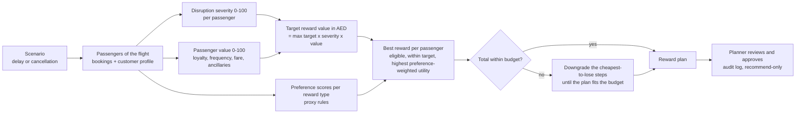

# Phase 5 Design: Passenger Reward Recommendation

Status: design for the MVP (2026-11-21). Decision record: [ADR 0012](adr/0012-passenger-reward-recommendation.md). Code: `backend/app/engine/rewards.py`.

## What it does
For a disrupted flight (delay or cancellation) the planner enters a **goodwill budget** in AED. The system works out how **severe** the disruption was for each passenger and how **valuable** each passenger is, then recommends a **reward type and amount** per passenger (meal voucher, gift voucher, lounge pass, miles, free ticket) so that the total stays within the budget. A person reviews and approves; nothing is sent to passengers.

## Flow

## Inputs and signals
| Quantity | Computed from | Range |
|---|---|---|
| Disruption severity (per passenger) | delay minutes or cancellation, a missed onward connection, the wait caused, vulnerable passenger (special assistance, infant, children) | 0-100 |
| Passenger value | the recovery-priority score (loyalty tier, travel frequency, fare value, ancillaries, journey, family booking) | 0-100 |
| Preference score per reward type | proxies: meal and seat bought, sales channel, fare family, loyalty and frequency, family booking | 0-1 |

## Reward catalogue (assumed values, AED, editable in `RewardRules`)
| Type | Options | Eligibility |
|---|---|---|
| Meal voucher | 50 | delay 60+ min, or cancelled |
| Gift voucher | 100, 200, 400 | always |
| Lounge pass | 120 | delay or wait of 2 h or more |
| Miles | 5,000 (100), 10,000 (200), 20,000 (400) | loyalty members only |
| Free ticket | 600 | severity 75 or more |

## Budget fitting
1. Each passenger gets a **target** = 600 AED x severity/100 x (0.4 + 0.6 x value/100).
2. Each eligible option has a utility = severity factor x value factor x preference x sqrt(cost), so many modest rewards beat one large one.
3. The plan starts from each passenger's best option within the target. If the total is over budget, the step that loses the least utility per AED saved is downgraded, one step at a time, until the plan fits.
4. **No overlap with care:** statutory and policy care (meals, hotel, transport, refund option under `care.py`, EU261 where it applies) is not paid from the goodwill budget and is shown separately in the scenario. A reward is never offered that repeats it: no meal voucher to a passenger whose care plan already gives meals, no lounge pass to one who already gets a hotel. Goodwill is what comes on top: vouchers, miles, lounge passes for passengers without a hotel, free tickets.

## How the recommendation is built, step by step
Code: `backend/app/engine/rewards.py` (rules, plan) and `backend/app/ml/reward_pref.py` (preference model).

**1. Who is in the plan.** Every passenger of the flight except infants (they travel on an adult's ticket) and non-revenue staff passengers. A passenger who misses a connection also has a care plan (see below).

**2. Disruption severity, 0-100, per passenger** (`severity()`):
| Factor | Points |
|---|---|
| Delay | delay minutes / 240, at most 1, times 50 (a 4 h delay or more gives 50) |
| Flight cancelled | 60 instead of the delay points |
| Missed an onward connection | +25 |
| Wait for the next flight (from the care plan) | wait minutes / 480, at most 1, times 15 |
| Cancelled **and** an onward connection is booked | +12 (the rest of the journey breaks with the cancelled leg) |
| Cancelled **and** a return flight is booked | +6 (the return has to be re-planned) |
| Special assistance, infant or children on the booking | +10 |
The total is capped at 100 and the reasons are kept for the "More data" view. The flight-level label is minor (below 25), moderate (below 50), major (below 75) or severe, from the delay or cancellation alone.

**2b. Upcoming flights (connection, return, later flights).** For every passenger the plan looks at what else is booked after this flight on the same booking (`store.onward_segments`, next 60 days): the *next* segment is a **connection** when it leaves from where this flight lands within 24 h of this departure; a **return** is any later segment that comes back to this flight's origin; the count of later segments is kept too. They are used three ways: (a) in a cancellation they raise severity (above); (b) the journey component of the passenger-value score now sees the real connection and number of segments; (c) they make the rewards usable on a later flight more likely to be taken: gift voucher +0.10, miles +0.10 (members), free ticket +0.15 (return flight booked first), lounge pass +0.10 when connecting. The same three signals are inputs of the preference model. "More data" shows the connection, return, the number of later flights and the next one.

**3. Passenger value, 0-100.** The recovery-priority score of the passenger (loyalty tier, travel frequency, fare value, ancillaries, journey complexity, family booking; weights as in the priority module) turned into a rank among the passengers of the flight: the share of the other passengers who score lower.

**4. Target amount, AED** = 600 x severity/100 x (0.4 + 0.6 x value/100). A passenger with no severity gets nothing; the most affected, most valuable passenger gets up to AED 600.

**5. Which rewards are allowed for a passenger** (`eligible_options()`):
- meal voucher: a delay or wait of 60 minutes or more, and **no meals in the care plan**;
- gift voucher: always (AED 100, 200, 400);
- lounge pass: a delay or wait of 120 minutes or more, and **no hotel in the care plan**;
- miles: loyalty members only (worth AED 100, 200, 400);
- free ticket: severity 75 or more;
- only options whose cost is within the passenger's target.
Care (meals, hotel, transport, refund option) comes from `care.py`, is not paid from the goodwill budget, and is never repeated by a reward.

**6. How likely the passenger is to take each reward.** First version: proxy rules, kept as the fallback.
| Reward | Points (base, then added) | Clues |
|---|---|---|
| Meal voucher | 0.30, +0.40, +0.20 | bought a meal on the booking, travelling with children |
| Gift voucher | 0.20, +0.25, +0.15 | books online or in the app, Basic or Value fare |
| Lounge pass | 0.15, +0.45, +0.20, +0.20 | paid for a seat, Ultimate fare, frequent traveller |
| Miles | 0 for non-members; 0.30, +0.30, +0.20 | loyalty member, regular or frequent traveller, a tier |
| Free ticket | 0.20, +0.30, +0.30, +0.20 | frequent traveller, Gold or Platinum or Ultimate fare, travels with others |
Now the trained model gives this probability instead (section "Preference model").

**7. Choosing the reward.** Utility of an option = severity/100 x (0.4 + 0.6 x value/100) x chance of acceptance x square root of the cost. The square root means several modest rewards beat one large one. For each passenger the options within the target are listed cheapest first, keeping only those that add utility; the plan starts from the best one.

**8. Fitting the budget.** If the plan costs more than the budget, one step is downgraded at a time: the passenger whose downgrade loses the least utility per AED saved drops to the next cheaper option (or to none). This repeats until the plan fits. The result is deterministic, never exceeds the budget, and shows how much of the full plan the budget covers.

**9. Approval.** The plan is computed on request and not stored. The planner reviews it and approves through the existing decisions endpoint (target `rewards:<budget>`), which goes to the audit log. Nothing is sent to passengers.

### What is a rule and what is a trained model
| Part | Kind |
|---|---|
| Disruption severity | Rules (formula above) |
| Passenger value | Rules (the priority score, as a rank) |
| Target amount, eligibility, catalogue, care exclusion, budget fitting | Rules and optimisation |
| Chance a passenger accepts a reward | **Trained model** (LightGBM) on simulated history; proxy rules as fallback |

## Limits stated plainly
- Preferences are **proxies**, not stated preferences: no redemption history exists. The UI labels them as assumptions.
- The catalogue values and the severity weights are assumptions to confirm with the airline.
- Everything is explainable: each recommendation lists the clues that produced it.

## Preference model (synthetic training data)
- No real redemption history exists, so ingest stage 4 (`backend/app/ml/reward_pref.py`) **simulates** past offers and accept/decline outcomes for the real passenger profiles from an assumed behaviour model, then trains a LightGBM classifier: P(accept | passenger, reward type, amount, severity).
- The plan uses this probability in place of the proxy rules (utility = severity x value x P(accept) x sqrt(cost)). If the model file is missing, the proxy rules are used.
- Held-out passengers (never split across train and test) are scored against two baselines: the average acceptance of each reward type and the first version's proxy rules. Numbers: [reward-model-card.md](../testing/reward-model-card.md).
- **What this proves and does not prove:** the model recovers the assumed behaviour; it says nothing about real customers. The simulated history, the model card and the UI all label it synthetic.
- **How the simulated history is made** (`generate_history`): each of up to 150,000 real revenue passenger profiles gets two offers with a random reward type, amount and severity (Beta-shaped, mean about 47). Whether it is accepted is drawn from a logistic rule with these assumed effects: meal buyers and families take meals; online bookers and price-conscious fares take gift vouchers; seat buyers, Ultimate fares and frequent travellers take lounge passes (families less); miles are taken almost only by members, more by frequent travellers and Silver and above; free tickets are taken more by frequent travellers, Gold and Platinum, Ultimate fares and groups; acceptance rises with severity, peaks when the amount matches the severity, and each passenger has a personal random taste. The assumptions are listed in the model card.
- **Training:** one LightGBM classifier on passenger features (fare family, channel, loyalty tier, frequency, meal, seat, ancillaries, fare, baggage, party size, children, infants, flights in 12 months, member) plus the offer (type, amount, severity). Whole passengers are held out together (20% test, 4 validation folds).
- **Tuning and comparison:** 40 Optuna trials for LightGBM and 25 for XGBoost, compared with logistic regression, random forest, CatBoost and a type-average baseline. The tree models tie and tuning gains almost nothing; the oracle bound (the simulator's own probability) shows the model closes about 61% of the possible log-loss gap. [reward-model-selection.md](../testing/reward-model-selection.md).
- **Replacing it with real data:** swap `generate_history` for the airline's offer log (same columns: passenger features, reward type, amount, severity, accepted). Nothing else changes.
