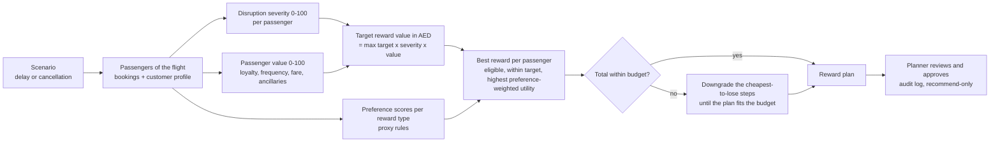

# Phase 5 Design: Passenger Reward Recommendation

Status: design for the MVP (2026-11-21). Decision record: [ADR 0010](adr/0010-passenger-reward-recommendation.md). Code: `backend/app/engine/rewards.py`.

## What it does
For a disrupted flight (delay or cancellation) the planner enters a **goodwill budget** in AED. The system works out how **severe** the disruption was for each passenger and how **valuable** each passenger is, then recommends a **reward type and amount** per passenger (meal voucher, shopping voucher, lounge pass, miles, free ticket) so that the total stays within the budget. A person reviews and approves; nothing is sent to passengers.

## Flow

## Inputs and signals
| Quantity | Computed from | Range |
|---|---|---|
| Disruption severity (per passenger) | delay minutes or cancellation, a missed onward connection, the wait caused, vulnerable passenger (special assistance, infant, children) | 0-100 |
| Passenger value | the recovery-priority score (loyalty tier, travel frequency, fare value, ancillaries, journey, family booking) | 0-100 |
| Preference score per reward type | proxies: meal and seat bought, sales channel, fare family, loyalty and frequency, family booking | 0-1 |

## Reward catalogue (assumed values, AED, editable in `RewardRules`)
| Type | Options | Eligibility |
|---|---|---|
| Meal voucher | 50 | delay 60+ min, or cancelled |
| Shopping voucher | 100, 200, 400 | always |
| Lounge pass | 120 | delay or wait of 2 h or more |
| Miles | 5,000 (100), 10,000 (200), 20,000 (400) | loyalty members only |
| Free ticket | 600 | severity 75 or more |

## Budget fitting
1. Each passenger gets a **target** = 600 AED x severity/100 x (0.4 + 0.6 x value/100).
2. Each eligible option has a utility = severity factor x value factor x preference x sqrt(cost), so many modest rewards beat one large one.
3. The plan starts from each passenger's best option within the target. If the total is over budget, the step that loses the least utility per AED saved is downgraded, one step at a time, until the plan fits.
4. Statutory care (meals and hotel under the care rules, EU261 where it applies) is not paid from the goodwill budget and is shown separately in the scenario.

## Limits stated plainly
- Preferences are **proxies**, not stated preferences: no redemption history exists. The UI labels them as assumptions.
- The catalogue values and the severity weights are assumptions to confirm with the airline.
- Everything is explainable: each recommendation lists the clues that produced it.

## Preference model (synthetic training data)
- No real redemption history exists, so ingest stage 4 (`backend/app/ml/reward_pref.py`) **simulates** past offers and accept/decline outcomes for the real passenger profiles from an assumed behaviour model, then trains a LightGBM classifier: P(accept | passenger, reward type, amount, severity).
- The plan uses this probability in place of the proxy rules (utility = severity x value x P(accept) x sqrt(cost)). If the model file is missing, the proxy rules are used.
- Held-out passengers (never split across train and test) are scored against two baselines: the average acceptance of each reward type and the first version's proxy rules. Numbers: [reward-model-card.md](../testing/reward-model-card.md).
- **What this proves and does not prove:** the model recovers the assumed behaviour; it says nothing about real customers. The simulated history, the model card and the UI all label it synthetic.
- **Replacing it with real data:** swap `generate_history` for the airline's offer log (same columns: passenger features, reward type, amount, severity, accepted). Nothing else changes.
