# Disruption Advisor System Architecture

Disruption Advisor helps an airline's **Operations Control Centre (OCC)** and **Passenger Control Unit (PCU)** handle a flight disruption before it cascades. For a delayed or cancelled flight, it:
1. Finds every downstream flight on the same aircraft rotation and every passenger whose journey breaks, over the next 7 days.
2. Compares recovery options (MVP: absorb the delay, or swap in a same-type aircraft) on delay, passengers affected and cost.
3. Ranks the affected passengers with transparent, configurable priority tiers and weights.
4. Assigns them to alternative flights within real seat inventory.
5. Explains every recommendation and drafts the passenger messages.

It **recommends only**: a person approves or rejects every action (requirement UC5, decision Q21).

**Carrier scope:** only the airline's own flights (G9). Partner and other carriers present in the extracts (3L, 3O, E5, 9P, 4P) are excluded from the operating data, the swap candidates and the rebooking alternatives (`OPERATING_CARRIERS=G9`). Including them is a future enhancement (delivery plan, phase 4).

Requirement sources: the UC5 use-case document (`Disruption_Management_UC5.docx`), the briefing transcript, the product-owner Q&A of 2026-11-20 and the clarification register (Q1–Q30). Domain background comes from the team's airline knowledge base (disruption management topic), which is not part of this repository.

## 1. System context

## 2. Containers (Docker Compose)

- **Two stores, each for what it does best.** DuckDB holds the large, read-mostly airline extracts: 27.9M booking rows reduced to the operating window and aggregates. PostgreSQL holds what users create (scenarios, decisions, audit), with migrations and backups.
- **The ingest job** turns the raw extracts into clean, typed tables. It applies the data rules (UTC/local time, active bookings, curtail/oversell capacity) and records every mismatch instead of failing (PO Q&A).

## 3. Components inside the API
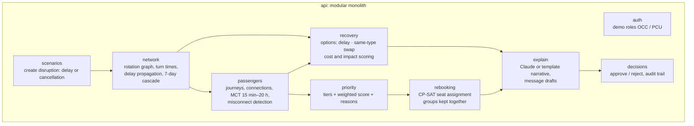
| Module | Owns | Key rule sources |
|---|---|---|
| `network` | Flight legs, tails, minimum turn time, downstream propagation | Rotation file; turn-time defaults per type (configurable) |
| `passengers` | Journeys built from active segments; connections at SHJ | MCT table; connection window 15 min–20 h (Q8) |
| `recovery` | Recovery options and their KPIs: delay min, pax affected, misconnects, cost | Cost defaults (Q15, configurable) |
| `priority` | Strict tiers then weighted score, with per-attribute contributions | Rule defaults Q12 (synthetic README) |
| `rebooking` | Alternative flights and seat assignment | Inventory allocation incl. curtail/oversell (Q10, PO) |
| `explain` | Natural-language reasons and English message drafts | Claude API; deterministic templates as fallback (Q26) |
| `decisions` | Approvals, rejections, who/when/what | Human-in-the-loop (Q21) |

## 4. Data flow and model
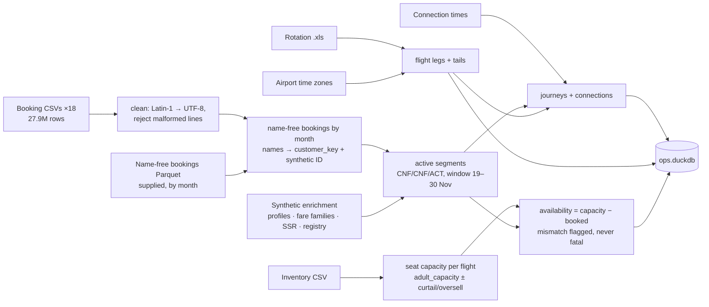
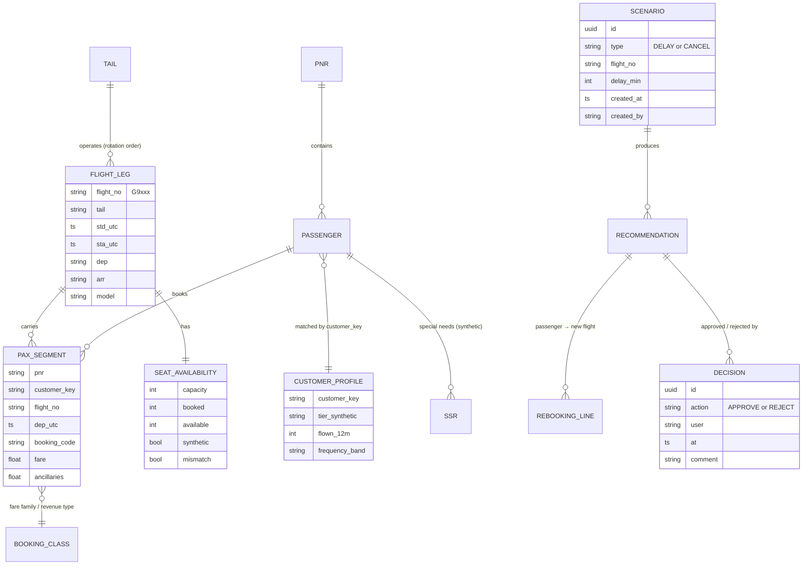
ops.duckdb holds the `FLIGHT_LEG` … `SSR` entities and is rebuilt by `ingest`. PostgreSQL holds `SCENARIO`, `RECOMMENDATION`, `REBOOKING_LINE`, `DECISION` and weight profiles.

## 5. Scenario A: inbound delay at the hub (delay vs aircraft swap)
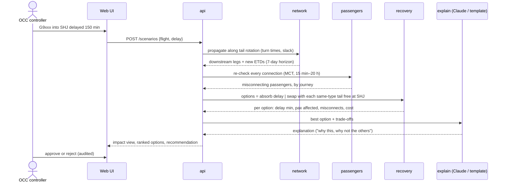

## 6. Scenario B: cancellation with too few seats (priority + rebooking)
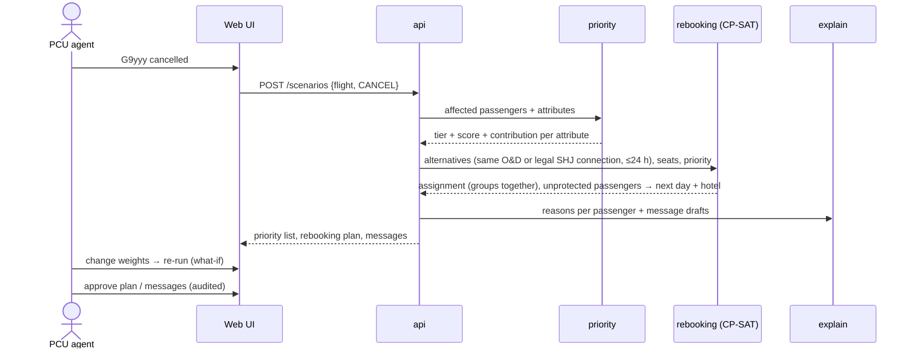

## 7. Priority decision logic
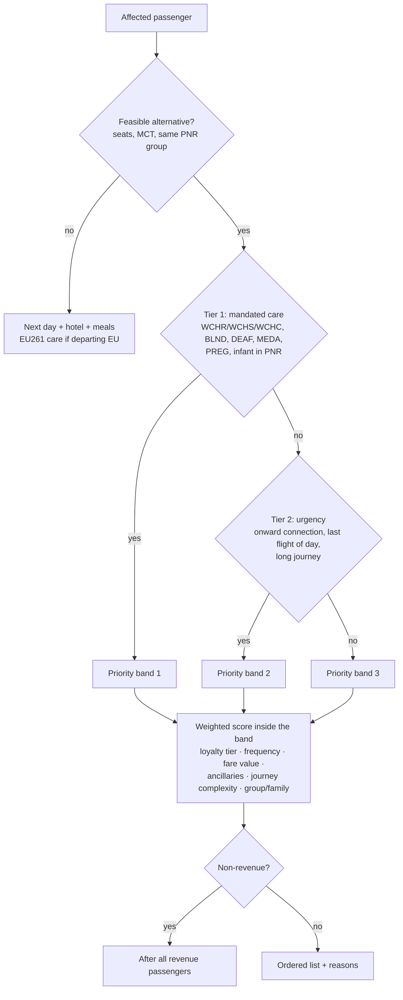
The commercial score never moves a passenger across a legal or care tier (UC5: "respect passenger rights … independently of commercial scores"). Unaccompanied minors are out of scope (decision 2026-11-21; future enhancement).

**Care while waiting** (`app/engine/care.py`, configurable):

| Wait for the new flight | Care offered |
|---|---|
| Under 2 h | None |
| 2 h or more | Meal vouchers, one per 4 h (at most 4) |
| 8 h or more, or overlapping the local night (01:00–05:00) by 2 h or more | Hotel room and airport↔hotel transport as well |
| No seat within 24 h | Treated as next day: hotel, transport and meals |

- **Refund option:** offered from 5 h of waiting, and to anyone without a seat (refund + free return to origin, or a free date change).
- **Flags:**
  - transfer passengers needing a hotel: transit visa or airside hotel;
  - special assistance: re-book it on the new flight;
  - pregnancy: fit-to-fly check;
  - infants: supplies and a priority room.
- **Where it shows:** care costs are included in the rebooking totals and the passenger message.

## 8. Deployment

- PostgreSQL is **not** published on 5432; only `web` is published.
- Secrets live only in the server's `.env` (mode 600), never in git.
- The incremental plan (MVP, then the later phases, each needing approval) is in [../delivery/MVP_AND_INCREMENTAL_PLAN.md](../delivery/MVP_AND_INCREMENTAL_PLAN.md).

**Published ports now (ADR 0015, `docs/architecture/adr/0015-published-ports-ui-8080-api-8888.md`):** the UI is on `http://92.5.154.198:8080` (`web`, nginx; its own `/api` calls go to `api:8000` inside Compose) and the API is published directly on `http://92.5.154.198:8888/api/...`. Both are plain HTTP. The diagrams above show the original MVP design with a single port 8888.

## 9. Cross-cutting concerns
- **Security:**
  - Login with demo roles; credentials come from server secrets (ADR 0004). As of now the distinct roles are **OCC** and **Evaluator** (Model Card and Test data views); **PCU** has the same access as OCC. Details: README.md, section Roles.
  - Strict input validation; RFC 9457 errors; CSP and security headers at nginx; non-root containers.
  - Passenger data is treated as real (Q3): no names or contact details go to the LLM, only the minimum fields per message.
- **Explainability:** every option, score and assignment carries machine-readable reasons (attribute contributions, binding constraints), which the UI shows. The LLM only rewrites these into prose and never decides.
- **Robustness:** booking vs inventory mismatches are flagged and the run continues (PO Q&A). Synthetic values are labelled in the UI.
- **Observability:** JSON logs with request id; `/health/live` and `/health/ready` (PostgreSQL and ops store); container healthchecks.
- **Time:** all logic runs in UTC; local times come from the airport time-zone table (Q9, Q22).
- **Limits (MVP):** G9 flights only (no partner or other carriers), no crew legality (no crew data), no equipment change, no bus legs, simulated "now" = 2026-11-20 (Q2).

## 10. Phase 2: Predict (approved on 21 Nov 2026)
Phase 2 adds a forward view (which flights are likely to be late in the next 7 days, and which passengers are likely to misconnect) (HTTPS and nightly backups, first planned here, were moved to phase 6 on 2026-11-21; see §10.3). The engine and the human approval loop of phase 1 are unchanged: predictions only rank and pre-fill, a person still runs and approves the scenario.

### 10.1 Delay-risk pipeline
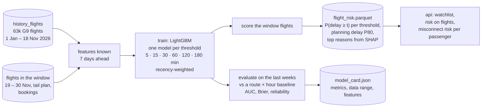
- **Runs in the ingest** (stage 3, after the operating picture), so a new data drop retrains and rescores without a separate service. Deterministic (fixed seed, LightGBM `deterministic` mode with 4 threads), so the same data gives the same model.
- **Features known 7 days ahead only** (no actual times of the day itself): departure station, arrival station, departure hour (local) and weekday, aircraft type, position of the flight in the aircraft's day, scheduled turn buffer before it, booked load factor, and the recent delay rate of the station and of the route (28 days, ending 7 days before the flight, so it is known in time).
- **Time-ordered validation**, never random: train on the older history, test on the most recent 28 days. Isotonic calibration was tested and dropped (worse under month-to-month drift). The model card states the numbers and is shown in the UI.
- **Reasons:** LightGBM's built-in TreeSHAP contributions, mapped to plain phrases ("evening departures from SHJ run late", "tight 40-minute turn").

### 10.2 From delay risk to passengers
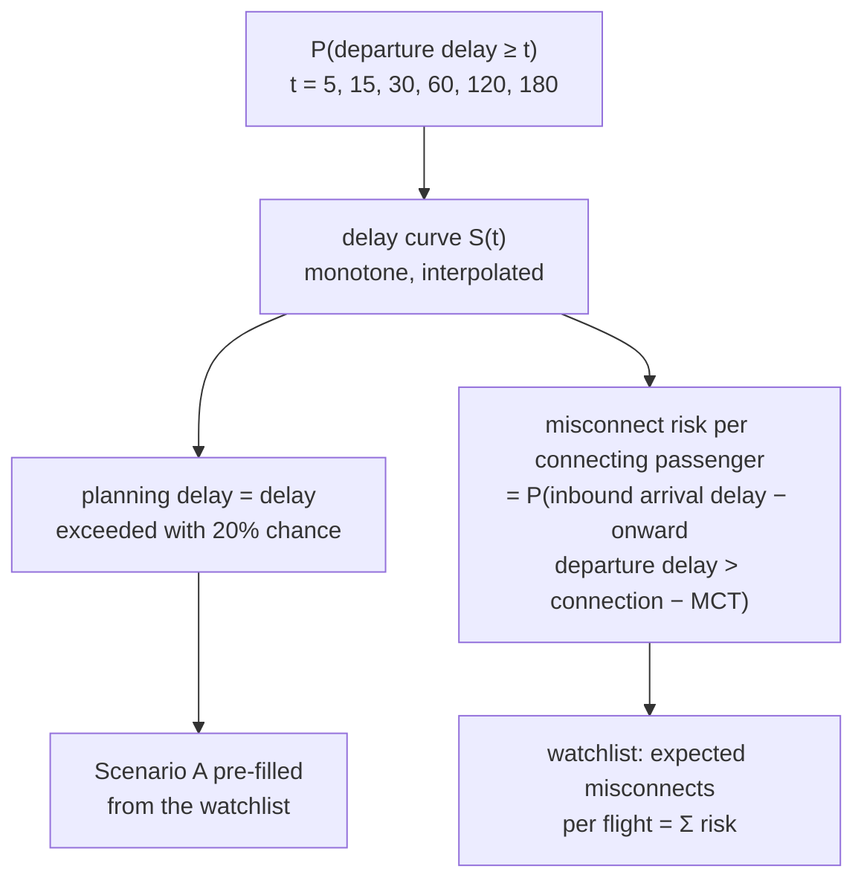
- The inbound arrival delay has its own curve (a second set of LightGBM models trained on actual arrival delays), and the onward flight's departure-delay curve is included, so a late onward flight saves some connections. The two delays are taken as independent. Back-tested on past connections: 0.70 predicted vs 0.69 observed (model card).

### 10.3 Deployment additions (moved to phase 6; not built yet)
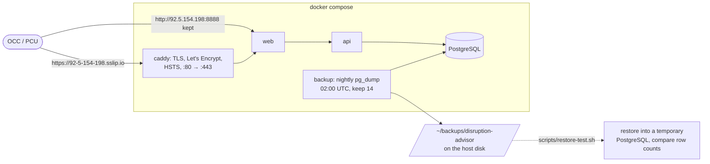
- **HTTPS:** Caddy obtains and renews the certificate itself. sslip.io maps the hostname to the server IP, so no DNS setup is needed. `:8888` stays for the existing links.
- **Backups** stay on the server disk (no off-site target was supplied); off-site copies are a phase 4 item. The restore test is run after deployment and recorded.
- Details: [ADR 0008](adr/0008-delay-risk-model.md), [ADR 0009](adr/0009-https-and-backups.md).

## 11. Phase 3: Agent and what-if (approved on 21 Nov 2026)
Phase 3 adds three things on top of phases 1 and 2. The engine still computes every number, and a person still approves every action.
1. **Two more recovery levers** for a delay: cancel a downstream round trip, and consolidate (the same, when every passenger fits on other flights on the same route that day).
2. **Strategies compared side by side.** "Lowest cost", "Protect passengers" and "Least delay" each pick their best option from the same option list.
3. **A Claude agent** investigates a disruption with read-only engine tools. It explains each step and submits one of the engine's options as its recommendation. A deterministic planner with the same tools runs when the AI is off or fails.

### 11.1 Recovery options for a delay
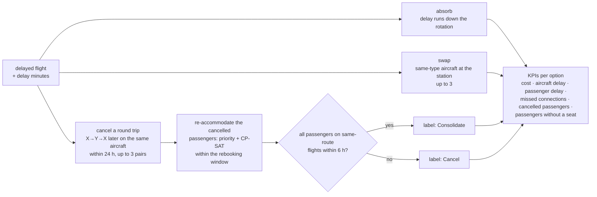
- **Why a round trip:** cancelling a pair X→Y→X takes the aircraft out of the rotation for that time and puts it back where it was scheduled to be, so the delay stops spreading without moving another aircraft. Cancelling a single flight would leave the aircraft at the wrong station.
- **Same treatment for everyone:** passengers of a cancelled flight, and passengers who miss a connection, are ranked and rebooked with the phase 1 rules: strict tiers, weighted score, CP-SAT, PNRs kept together. Care (meals, hotel) and EU261 follow the same rules too.
- **Rebooking is checked for every option**, not only for the one on screen, so options can be compared fairly on the passengers left without a seat. CP-SAT runs about 5–8 times per scenario, on small passenger sets.

### 11.2 Strategies
| Strategy | Picks the option with the lowest… (ties broken left to right) |
|---|---|
| Lowest cost (default; same as phases 1–2) | estimated cost → missed connections → aircraft delay minutes → flights cancelled → flights moved to another aircraft → option key |
| Protect passengers | passengers without a seat → passengers disrupted (missed connections + cancelled) → passenger delay minutes → cost → flights cancelled → key |
| Least delay | passenger delay minutes → cost → flights cancelled → key |

- **Passenger delay minutes** = Σ (delay × passengers) over delayed flights + the arrival delay of every rebooked passenger + 24 h for every passenger without a seat. The 24 h figure is an assumption, stated in the UI.
- The scenario stores the chosen strategy. "Recommended" means that strategy's pick. Approving another option is still an override with a required reason. Switching the strategy changes no numbers; it only changes which option is recommended.
- The comparison panel shows each strategy's pick side by side with the same KPIs. The option list is computed once, so the comparison is instant.

### 11.3 Agent loop
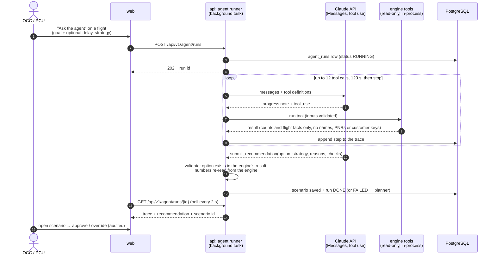
**Tools.** All are read-only, and their inputs are validated. Each returns a compact JSON summary.

| Tool | Returns |
|---|---|
| `find_flights` | flights matching a number or route on a day (id, times, aircraft, load) |
| `flight_status` | one flight: schedule, aircraft, booked passengers, connecting passengers, delay risk and reasons (phase 2) |
| `aircraft_rotation` | the aircraft's flights over the next 24–48 h, with turn buffers |
| `assess_delay` | the delay scenario for a flight and delay: every option with its KPIs, plus each strategy's pick |
| `compare_strategies` | the three strategy picks for the assessed scenario, with the trade-offs between them |
| `passenger_impact` | for one option: missed connections, rebooked, without a seat, care, priority tiers (counts only) |
| `watchlist` | the phase 2 watchlist: top flights by expected missed connections |
| `submit_recommendation` | final answer: `option_key`, `strategy`, 2–4 reasons, risks and checks for the controller (strict schema) |

- **Recommend-only.** No tool changes data or approves anything. The agent's result is saved as a normal scenario with its trace attached, and the person approves in the existing flow.
- **Grounded.** The recommendation must name an option the engine produced. The figures on screen are re-read from the engine result, never taken from the model's text.
- **Privacy (ADR 0007 rules).** Tool results carry no names, PNRs, contact details or customer keys. Passengers appear only as counts by tier, need or route.
- **Bounded.** At most 12 tool calls, 120 s and one run at a time per user. On timeout, error, refusal or no API key, the **deterministic planner** runs the same tools in a fixed order: status → assess (given delay, else the predicted planning delay with a 15-minute floor, else 60 min) → compare → impact for the strategy's pick. It writes a template explanation, and the trace shows `source: planner`.
- **Trace.** Each step stores the model's progress note, the tool, its inputs and a one-line result. The UI shows the steps live while the run is going.

### 11.4 Data and API additions
- PostgreSQL table `agent_runs` (Alembic 0002): `id`, `flight_id`, `goal`, `strategy`, `status` (RUNNING · DONE · FAILED), `source` (`ai:<model>` or `planner`), `trace` JSONB, `recommendation` JSONB, `scenario_id`, `created_by`, timestamps, token usage.
- New fields in the scenario result: `strategy`, per-option `strategy_rank`, and `cancelled_flights` / `cancelled_passengers` / `passengers_without_seat` / `passenger_delay_minutes`. Old scenarios are read with defaults.
- New endpoints:
  - `POST /api/v1/agent/runs`, `GET /api/v1/agent/runs/{id}`, `GET /api/v1/agent/runs`
  - `POST /api/v1/scenarios/{id}/strategy` (switch the strategy and recompute the recommendation; the comparison itself is part of every delay scenario result: `strategies`, per-option `picked_by`)
- UI:
  - a strategy comparison panel and a strategy switch in the delay view
  - an "Ask the agent" action on the launcher and the watchlist rows
  - an agent run page: live steps, recommendation, open scenario

- Details: [ADR 0010](adr/0010-tool-using-agent.md), [ADR 0011](adr/0011-cancel-consolidate-and-strategies.md).

## 12. Phase 5 and the 7-day tab (21 Nov 2026)

### 12.1 Passenger rewards
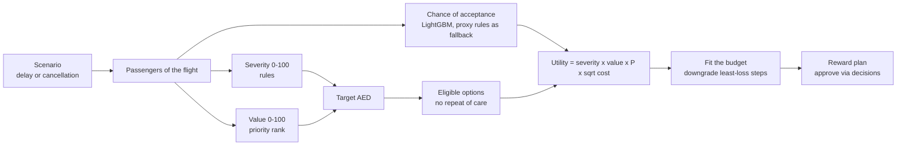
- **Stage 4 of the ingest** (`app/ml/reward_pref.py`) simulates the offer history, trains the model and writes `reward_model.txt`, `reward_model_card.json` and `reward_history_synthetic.parquet` into the ops volume. The API loads the model at start-up; without the file it uses the proxy rules.
- **API:** `POST /api/v1/scenarios/{id}/rewards` with `{"budget_aed": n}` returns the plan, computed on request and not stored. Approval uses the existing `/decisions` endpoint with target `rewards:<budget>`.
- **UI:** one passenger panel with two tabs in the delay and cancellation views: connection passengers, and rewards / compensation (budget box, summary, table of passenger, recommended reward and value, with "More data" per row).
- Details and every rule: [REWARDS_DESIGN.md](REWARDS_DESIGN.md), [ADR 0012](adr/0012-passenger-reward-recommendation.md).

### 12.2 Cascade formula check (7-day tab)
- **Stage 3b of the ingest** (`app/cascade_check.py`) tests the simple knock-on rule *next departure = max(scheduled departure, previous arrival + 40 min)* against the real departures of the last 30 days of punctuality history: consecutive flights of the same aircraft, the second leaving from where the first arrived, scheduled gap up to 24 h, where the rule predicts a knock-on. Extreme outliers (360 minutes or more of knock-on) are listed apart.
- It writes `cascade_check.json` (six figures, histogram, all pairs). `GET /api/v1/risk/cascade` serves it.
- **UI:** on the 7-day tab the sidebar shows six boxes (cascade pairs, mean delta, within +-15 min, within +-30 min, underestimates, overestimates) and "Expand the full view" opens the scatter, the delta histogram and the filterable table of pairs. On this tab the scenario launcher and recent scenarios are hidden.
- It is a read-only check of an assumption; it does not change any recommendation.
