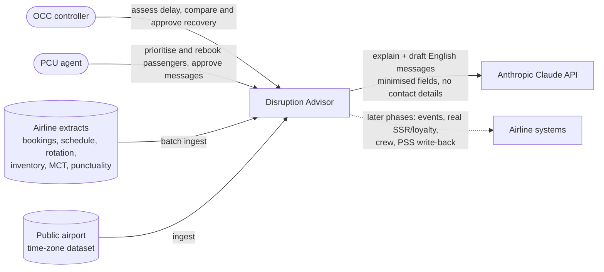
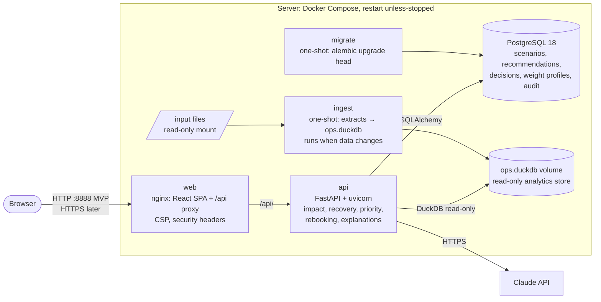
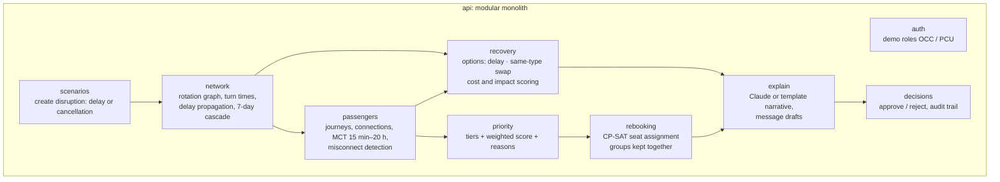
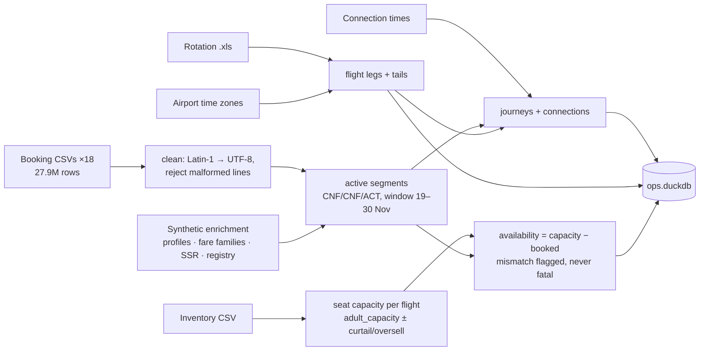
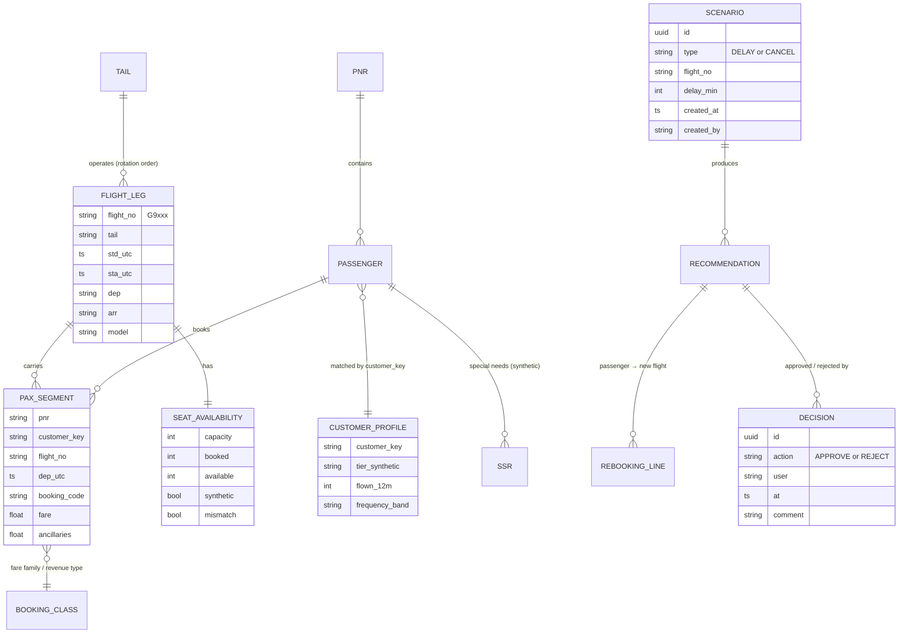
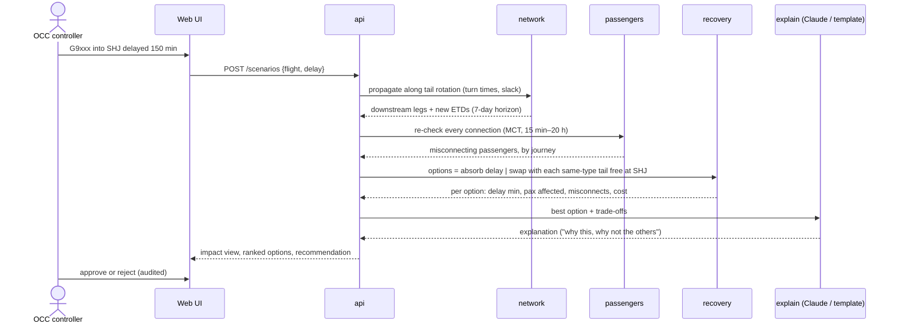
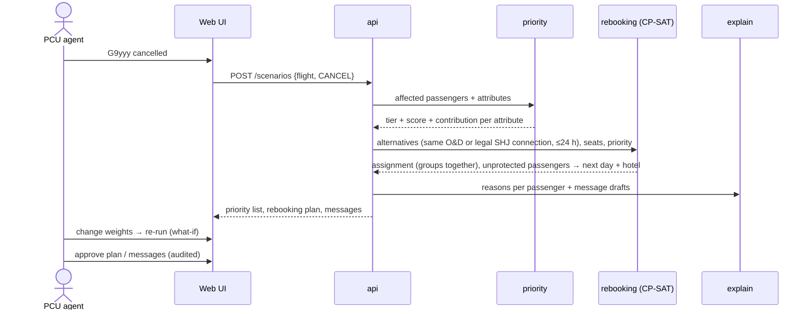
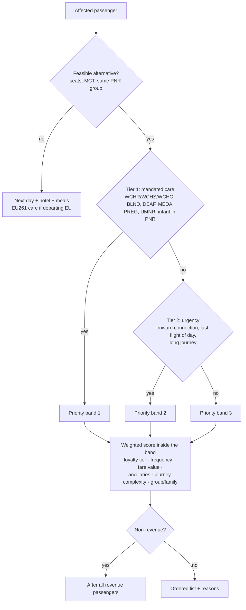
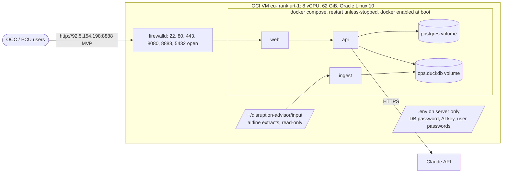

# Disruption Advisor System Architecture

Disruption Advisor helps an airline's **Operations Control Centre (OCC)** and **Passenger Control Unit (PCU)** handle a flight disruption before it cascades. For a delayed or cancelled flight, it:
1. Finds every downstream flight on the same aircraft rotation and every passenger whose journey breaks, over the next 7 days.
2. Compares recovery options (MVP: absorb the delay, or swap in a same-type aircraft) on delay, passengers affected and cost.
3. Ranks the affected passengers with transparent, configurable priority tiers and weights.
4. Assigns them to alternative flights within real seat inventory.
5. Explains every recommendation and drafts the passenger messages.

It **recommends only**: a person approves or rejects every action (requirement UC5, decision Q21).

Requirement sources: the UC5 use-case document (`Disruption_Management_UC5.docx`), the briefing transcript, the product-owner Q&A of 2026-11-20 and the clarification register (Q1–Q30). Domain background comes from the team's airline knowledge base (disruption management topic), which is not part of this repository.

## 1. System context

## 2. Containers (Docker Compose)

- **Two stores, each for what it does best.** DuckDB holds the large, read-mostly airline extracts: 27.9M booking rows reduced to the operating window and aggregates. PostgreSQL holds what users create (scenarios, decisions, audit), with migrations and backups.
- **The ingest job** turns the raw extracts into clean, typed tables. It applies the data rules (UTC/local time, active bookings, curtail/oversell capacity) and records every mismatch instead of failing (PO Q&A).

## 3. Components inside the API

| Module | Owns | Key rule sources |
|---|---|---|
| `network` | Flight legs, tails, minimum turn time, downstream propagation | Rotation file; turn-time defaults per type (configurable) |
| `passengers` | Journeys built from active segments; connections at SHJ | MCT table; connection window 15 min–20 h (Q8) |
| `recovery` | Recovery options and their KPIs: delay min, pax affected, misconnects, cost | Cost defaults (Q15, configurable) |
| `priority` | Strict tiers then weighted score, with per-attribute contributions | Rule defaults Q12 (synthetic README) |
| `rebooking` | Alternative flights and seat assignment | Inventory allocation incl. curtail/oversell (Q10, PO) |
| `explain` | Natural-language reasons and English message drafts | Claude API; deterministic templates as fallback (Q26) |
| `decisions` | Approvals, rejections, who/when/what | Human-in-the-loop (Q21) |

## 4. Data flow and model

ops.duckdb holds the `FLIGHT_LEG` … `SSR` entities and is rebuilt by `ingest`. PostgreSQL holds `SCENARIO`, `RECOMMENDATION`, `REBOOKING_LINE`, `DECISION` and weight profiles.

## 5. Scenario A: inbound delay at the hub (delay vs aircraft swap)

## 6. Scenario B: cancellation with too few seats (priority + rebooking)

## 7. Priority decision logic

The commercial score never moves a passenger across a legal or care tier (UC5: "respect passenger rights … independently of commercial scores").

## 8. Deployment

- PostgreSQL is **not** published on 5432; only `web` is published.
- Secrets live only in the server's `.env` (mode 600), never in git.
- The incremental plan (MVP, then the later phases, each needing approval) is in [../delivery/MVP_AND_INCREMENTAL_PLAN.md](../delivery/MVP_AND_INCREMENTAL_PLAN.md).

## 9. Cross-cutting concerns
- **Security:**
  - Login with two demo roles (OCC, PCU); credentials come from server secrets (ADR 0004).
  - Strict input validation; RFC 9457 errors; CSP and security headers at nginx; non-root containers.
  - Passenger data is treated as real (Q3): no names or contact details go to the LLM, only the minimum fields per message.
- **Explainability:** every option, score and assignment carries machine-readable reasons (attribute contributions, binding constraints), which the UI shows. The LLM only rewrites these into prose and never decides.
- **Robustness:** booking vs inventory mismatches are flagged and the run continues (PO Q&A). Synthetic values are labelled in the UI.
- **Observability:** JSON logs with request id; `/health/live` and `/health/ready` (PostgreSQL and ops store); container healthchecks.
- **Time:** all logic runs in UTC; local times come from the airport time-zone table (Q9, Q22).
- **Limits (MVP):** no crew legality (no crew data), no equipment change, no bus legs, simulated "now" = 2026-11-20 (Q2).
