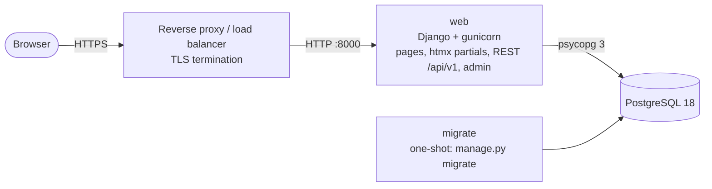

# Sample App System Architecture

TODO-PRODUCT: one paragraph on what the system does and for whom.

## 1. Context and containers

- **web**: one stateless container, scaled horizontally behind the proxy. Sessions are stored in the database.
- **migrate**: runs migrations before `web` starts (Compose `service_completed_successfully`; in production, a release step).
- TODO-PRODUCT: external systems (email, SSO, payment, ...), each with its integration contract.

## 2. Code structure (modular monolith)
| Path | Responsibility |
|---|---|
| `config/` | Settings (environment variables only), URLs, WSGI/ASGI, logging |
| `apps/core/` | Cross-cutting: health endpoints, request-id middleware, home page |
| `apps/<context>/` | One Django app per bounded context: models, migrations, forms, serializers, views, URLs, tests. Apps talk through each other's service functions, never through each other's tables |
| `templates/`, `static/` | Shared layout, htmx, CSS |

TODO-PRODUCT: list the bounded contexts (apps) and what each owns.

## 3. Cross-cutting concerns
- **Security:** session auth with CSRF; `IsAuthenticated` by default on the API; HSTS/SSL-redirect/secure cookies from environment settings; `X-Frame-Options: DENY`; nosniff; secrets only from environment variables.
- **Observability:** JSON logs with `request_id`; `/health/live` (process) and `/health/ready` (database); container healthchecks.
- **Data:** UTC timestamps (`USE_TZ`); migrations reviewed in PRs; `makemigrations --check` in the gate.
- **Deployment:** see `README.md` (Compose locally; production = the same image behind TLS with managed PostgreSQL).
