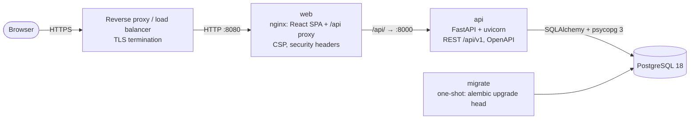

# Sample App System Architecture

TODO-PRODUCT: one paragraph on what the system does and for whom.

## 1. Context and containers

- **web**: static SPA plus a reverse proxy, so the browser sees one origin (no CORS needed).
- **api**: stateless and scaled horizontally; only `web` reaches it (not published in Compose).
- **migrate**: runs Alembic before `api` starts (in production, a release step).
- TODO-PRODUCT: external systems (identity provider, email, ...), each with its integration contract.

## 2. Code structure
| Path | Responsibility |
|---|---|
| `backend/app/main.py` | Application factory: settings, logging, engine, middleware, error handlers, routers |
| `backend/app/config.py` | Settings from environment variables |
| `backend/app/db.py`, `models.py` | SQLAlchemy base, session dependency, ORM models |
| `backend/app/schemas.py` | Pydantic request/response models (the API contract) |
| `backend/app/<feature>.py` (or a package per bounded context) | Routers and their service logic |
| `backend/app/errors.py`, `middleware.py`, `logging.py`, `health.py` | Cross-cutting: RFC 9457 errors, request id, structured logs, health |
| `backend/alembic/` | Migrations (a test fails when models and migrations differ) |
| `frontend/src/api.ts` | Typed API client (mirrors `schemas.py`; contract at `/api/openapi.json`) |
| `frontend/src/` | React components with loading, empty, error and success states |

TODO-PRODUCT: list the bounded contexts and what each owns.

## 3. Cross-cutting concerns
- **Security:** authentication per ADR 0004 (TODO-PRODUCT); strict input validation (`extra="forbid"`, length limits, bounded paging); CSP, nosniff, frame-deny and referrer policy at nginx; non-root containers; secrets only from environment variables.
- **Errors:** every error is `application/problem+json` (RFC 9457); unhandled errors are logged with the request id and return a generic 500.
- **Observability:** JSON logs with `request_id`; `/health/live`, `/health/ready` (database); container healthchecks.
- **Data:** UTC `timestamptz`; migrations via Alembic only.
